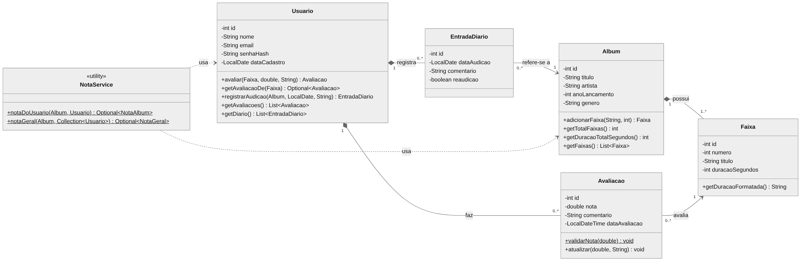
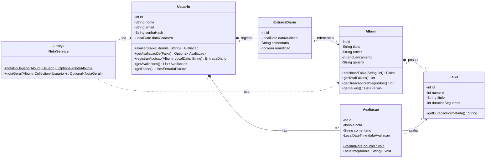

# SongLog — Documento de Projeto

**Projeto Integrador · Etapa 1 — Documentação, Diagrama de Classes e Esqueleto em Java**
Stack: Java (NetBeans) · MySQL · Git/GitHub

---

## 1. Apresentação

O **SongLog** é uma aplicação desktop para catalogar e avaliar música, inspirada no Letterboxd. Enquanto as plataformas de música tratam o álbum como uma nota única, o SongLog parte de outra premissa: **um disco é a soma das suas faixas**. O usuário avalia cada faixa e o sistema calcula a nota do álbum, ponderando pela duração de cada uma. Cada usuário também mantém um **diário de audição**, um registro cronológico do que ouviu e quando.

**Problema que resolve.** Uma nota única esconde o que importa: o disco com 3 obras-primas e 6 faixas de preenchimento recebe a mesma nota de um disco regular do começo ao fim. A avaliação faixa a faixa devolve essa informação, e o diário cria o hábito de registrar a própria escuta.

Este projeto é uma **nova ideia** (não retoma o PI anterior) e será desenvolvido em Java com banco de dados MySQL.

---

## 2. Descrição do projeto

Sistema desktop de uso local, com interface gráfica Swing e persistência em MySQL. Reúne três funcionalidades principais, cada uma em uma tela, mais o acesso à conta:

- **Catálogo:** cadastro e consulta de álbuns e de suas faixas (título, artista, ano, gênero, duração).
- **Avaliação:** nota de cada faixa e cálculo da nota ponderada do álbum, comparada à nota geral.
- **Perfil e Diário:** histórico de audições do usuário e estatísticas do seu perfil.

O sistema armazena cinco tipos de registro (`Usuario`, `Album`, `Faixa`, `Avaliacao`, `EntradaDiario`), detalhados na seção 8.

**Escopo desta versão.** Aplicação desktop nativa, um banco MySQL local e nenhum serviço web.

---

## 3. Descrição dos usuários

| Perfil | Quem é | O que espera do SongLog |
|---|---|---|
| **Amante de música** | Ouve muito, tem opinião forte sobre discos e faixas específicas. | Registrar nota por faixa sem atrito; ver por que um álbum ficou com determinada nota. |
| **Crítico casual** | Gosta de escrever sobre o que ouve, sem ser profissional. | Comentar faixas e audições; ter um histórico pessoal de opiniões. |
| **Catalogador** | Gosta de organizar: quer o acervo completo e correto. | Cadastrar álbuns com todas as faixas, durações e metadados sem duplicar registros. |

Os três perfis usam a mesma conta e as mesmas telas; a diferença está na intensidade de uso de cada funcionalidade. Não há papel de administrador nesta versão.

---

## 4. Necessidades observadas

1. Avaliar o álbum **por faixa** em vez de uma nota única, sem perder a visão geral do disco.
2. Ter uma nota de álbum **justa**: uma faixa de 12 minutos deve pesar mais que uma vinheta de 40 segundos.
3. Lembrar **quando** e **quantas vezes** ouviu cada disco.
4. Manter um catálogo local, próprio e sem depender de conexão com a internet.
5. Comparar a própria nota com a **nota geral** do álbum (média dos usuários).

---

## 5. Regras de negócio

| Cód. | Regra |
|---|---|
| **RN01** | Um álbum possui **N ≥ 1 faixas**, numeradas sequencialmente a partir de 1, sem repetição de número dentro do álbum. |
| **RN02** | Um álbum é único pela combinação **título + artista + ano de lançamento**. |
| **RN03** | A nota de uma faixa vai de **0,5 a 5,0, em passos de 0,5**. |
| **RN04** | Cada usuário tem **no máximo uma avaliação por faixa**. Reavaliar atualiza a existente (e a data). |
| **RN05** | A **nota do álbum para um usuário** é a média ponderada das faixas que ele avaliou, com peso igual à duração em segundos: `Σ(nota × duração) / Σ(duração)`. |
| **RN06** | Se o usuário avaliou apenas parte das faixas, a nota é exibida como **parcial** (ex.: "2/5 faixas"). |
| **RN07** | A **nota geral do álbum** é a média simples das notas de álbum dos usuários com **avaliação completa** (todas as faixas). Avaliações parciais não entram. |
| **RN08** | O **diário de audição** registra data, álbum e comentário opcional. Independe de avaliação. |
| **RN09** | O mesmo álbum pode aparecer várias vezes no diário do mesmo usuário; a partir da segunda, a entrada é marcada como **reaudição**. |
| **RN10** | A data de audição **não pode estar no futuro**. |
| **RN11** | O **e-mail** é único por usuário. A **senha nunca é armazenada em texto puro**, apenas seu hash (PBKDF2-HMAC-SHA256 com salt). |
| **RN12** | A duração de uma faixa é **maior que zero** (é o peso do cálculo). |
| **RN13** | Ao excluir um álbum, suas faixas e as avaliações dessas faixas são excluídas junto. Entradas de diário que citam o álbum também. |

**Exemplo de RN05.** Faixas A (10 min) e B (2 min), notas 5,0 e 3,0:
`(5,0 × 600 + 3,0 × 120) / 720 = 4,67`. Uma média simples daria 4,0.

---

## 6. Requisitos funcionais

Três funcionalidades centrais (uma tela cada), mais o acesso à conta.

| Cód. | Requisito | Tela |
|---|---|---|
| **RF01** | Cadastrar-se e autenticar-se (e-mail e senha). | Login / Cadastro |
| **RF02** | Cadastrar álbum com título, artista, ano e gênero. | **Catálogo** |
| **RF03** | Cadastrar, editar e remover as faixas de um álbum (título e duração). | **Catálogo** |
| **RF04** | Listar e buscar álbuns por título, artista ou gênero. | **Catálogo** |
| **RF05** | Avaliar cada faixa de um álbum com nota de 0,5 a 5,0 e comentário opcional. | **Avaliação** |
| **RF06** | Exibir a nota ponderada do álbum para o usuário, a indicação de parcial e a nota geral. | **Avaliação** |
| **RF07** | Registrar uma audição no diário (álbum, data, comentário). | **Perfil e Diário** |
| **RF08** | Listar o diário do usuário em ordem cronológica inversa. | **Perfil e Diário** |
| **RF09** | Exibir o perfil: totais de álbuns ouvidos, faixas avaliadas, nota média dada e últimas avaliações. | **Perfil e Diário** |
| **RF10** | Editar e excluir as próprias avaliações e entradas do diário. | Avaliação / Diário |

---

## 7. Requisitos não funcionais

| Cód. | Requisito |
|---|---|
| **RNF01** | **Plataforma:** aplicação desktop nativa em Java 17+, interface Swing, projeto Maven aberto no NetBeans. |
| **RNF02** | **Persistência:** MySQL 8 local, acessado por JDBC (MySQL Connector/J). |
| **RNF03** | **Arquitetura em camadas:** `model` (domínio), `service` (regras), `dao` (acesso a dados) e `view` (telas). A interface não contém SQL nem regras de negócio. |
| **RNF04** | **Segurança:** consultas com `PreparedStatement` (sem concatenação de SQL); senhas com hash e salt; credenciais do banco fora do repositório. |
| **RNF05** | **Integridade:** chaves estrangeiras e restrições `UNIQUE` no banco espelhando as regras RN01, RN02, RN04 e RN11. |
| **RNF06** | **Usabilidade:** interface limpa, tipografia legível, navegação por teclado nos formulários, mensagens de erro em português e específicas. |
| **RNF07** | **Desempenho:** telas principais respondem em menos de 1 s para catálogos de até 5 mil álbuns. |
| **RNF08** | **Versionamento:** Git/GitHub, com commits pequenos e mensagens descritivas. |
| **RNF09** | **Codificação:** UTF-8 em código-fonte e no banco (`utf8mb4`). |

---

## 8. Tipos de registro armazenados

Cinco entidades. Tipos já pensados para o MySQL (o script de criação do banco será produzido junto com a camada de acesso a dados).

### `Usuario`
| Campo | Tipo | Restrições |
|---|---|---|
| `id` | INT | PK, auto incremento |
| `nome` | VARCHAR(80) | obrigatório |
| `email` | VARCHAR(120) | obrigatório, **único** |
| `senha_hash` | VARCHAR(255) | obrigatório |
| `data_cadastro` | DATE | obrigatório |

### `Album`
| Campo | Tipo | Restrições |
|---|---|---|
| `id` | INT | PK, auto incremento |
| `titulo` | VARCHAR(120) | obrigatório |
| `artista` | VARCHAR(120) | obrigatório |
| `ano_lancamento` | SMALLINT | obrigatório |
| `genero` | VARCHAR(40) | opcional |
| | | **único** (`titulo`, `artista`, `ano_lancamento`) |

### `Faixa`
| Campo | Tipo | Restrições |
|---|---|---|
| `id` | INT | PK, auto incremento |
| `album_id` | INT | FK → `Album`, `ON DELETE CASCADE` |
| `numero` | SMALLINT | obrigatório |
| `titulo` | VARCHAR(120) | obrigatório |
| `duracao_segundos` | INT | obrigatório, > 0 |
| | | **único** (`album_id`, `numero`) |

### `Avaliacao`
| Campo | Tipo | Restrições |
|---|---|---|
| `id` | INT | PK, auto incremento |
| `usuario_id` | INT | FK → `Usuario` |
| `faixa_id` | INT | FK → `Faixa`, `ON DELETE CASCADE` |
| `nota` | DECIMAL(2,1) | obrigatório, entre 0,5 e 5,0 |
| `comentario` | VARCHAR(500) | opcional |
| `data_avaliacao` | DATETIME | obrigatório |
| | | **único** (`usuario_id`, `faixa_id`) |

### `EntradaDiario`
| Campo | Tipo | Restrições |
|---|---|---|
| `id` | INT | PK, auto incremento |
| `usuario_id` | INT | FK → `Usuario` |
| `album_id` | INT | FK → `Album`, `ON DELETE CASCADE` |
| `data_audicao` | DATE | obrigatório |
| `comentario` | VARCHAR(500) | opcional |
| `reaudicao` | BOOLEAN | obrigatório |

**Relacionamentos:** `Album 1—N Faixa` · `Usuario 1—N Avaliacao N—1 Faixa` (é a tabela associativa entre usuários e faixas) · `Usuario 1—N EntradaDiario N—1 Album`.

> **Decisão de modelagem.** `Artista` e `Genero` ficam como atributos de `Album` nesta versão. Separá-los em tabelas próprias resolveria a duplicação de nomes ("Miles Davis" escrito de duas formas), mas adiciona telas e junções que não pagam o custo num projeto com 3 telas. Fica registrado como evolução possível.

---

## 9. Diagrama de classes

A imagem do diagrama está em [`diagrama-de-classes.png`](diagrama-de-classes.png). O código-fonte dela ([Mermaid](https://mermaid.js.org/)) está abaixo e em `diagrama-de-classes.mmd`; o GitHub renderiza o bloco direto neste arquivo.





---

## 10. Estrutura de classes planejada

```
br.com.songlog
├── Main                      ponto de entrada (protótipo na Etapa 1; abre a janela quando as telas existirem)
├── model                     domínio: só dados e regras do próprio objeto
│   ├── Usuario
│   ├── Album
│   ├── Faixa
│   ├── Avaliacao
│   └── EntradaDiario
├── service                   regras que envolvem mais de um objeto
│   └── NotaService
├── util
│   ├── Validacao             validação de texto de entrada
│   ├── Tempo                 segundos → "m:ss"
│   └── SenhaUtil             hash de senha (PBKDF2)
├── dao          (futuro)     JDBC: UsuarioDAO, AlbumDAO, FaixaDAO, AvaliacaoDAO, DiarioDAO
└── view         (futuro)     Swing: TelaLogin, TelaCatalogo, TelaAvaliacao, TelaPerfilDiario
```

| Classe | Responsabilidade | Colaboradores |
|---|---|---|
| `Usuario` | Identidade da conta; cria/atualiza avaliações (RN04) e registra audições (RN09). | `Avaliacao`, `EntradaDiario` |
| `Album` | Metadados do disco e posse das faixas; numeração sequencial (RN01). | `Faixa` |
| `Faixa` | Título, número e duração (que é o peso do cálculo). | — |
| `Avaliacao` | Nota de um usuário para uma faixa; valida a escala (RN03). | `Usuario`, `Faixa` |
| `EntradaDiario` | Uma audição datada; valida a data (RN10). | `Usuario`, `Album` |
| `NotaService` | Nota ponderada por usuário (RN05/06) e nota geral (RN07). | `Album`, `Usuario` |

**Por que `NotaService` fora das entidades?** A nota geral depende de vários usuários; nenhuma entidade sozinha é dona desse cálculo. Com o banco integrado, o mesmo resultado poderá ser obtido por uma consulta SQL agregada; a classe fica como a especificação executável da regra.

**Igualdade de entidades.** `Faixa` e `Album` comparam por `id` (a chave do banco). Objetos ainda não salvos (`id == 0`) comparam por identidade. O `Main` simula os ids que o MySQL atribuirá.

---

## 11. Diretrizes de interface (resumo)

Design editorial, com traço brutalista refinado. A tela é um documento, não um aplicativo de cartões.

- **Cor:** fundo sólido claro de papel (`#F4F1EA`) e tinta quase preta (`#141414`). **Um único** acento (vermelho `#C8321E`), usado só para nota e ação primária. Sem gradientes, sem sombras difusas, sem transparência.
- **Tipografia:** serifada de alto contraste nos títulos de álbum (ex.: *Source Serif 4* ou *Playfair Display*); sem serifa neutra nos dados (*Inter*); monoespaçada nas durações e notas (*JetBrains Mono*), para alinhar colunas.
- **Estrutura:** filetes de 1 px em vez de caixas; tabelas alinhadas à grade; cantos retos; espaçamento generoso.
- **Nota:** o número em destaque, grande, em vez de estrelas decorativas.
- **Implementação:** Swing com o Look and Feel *FlatLaf* (uma dependência Maven) e tema customizado com essas cores.

---

## 12. Plano das etapas

| Etapa | Entrega | Situação |
|---|---|---|
| 1 | Documento de projeto, diagrama de classes e esqueleto em Java | Concluída |
| 2 | UX/UI: orientações, wireframes, esquema de cores e acessibilidade | Em andamento |
| 3 a 5 | Definidas conforme o enunciado de cada etapa | — |
