# SongLog — Etapa 2: UX/UI, Wireframes, Cores e Acessibilidade

Guia para montar o protótipo no Figma e, depois, implementar as telas em Swing.
Arquivos que acompanham este documento: [`design-tokens.json`](design-tokens.json) (cores, espaçamento e tipografia, para importar no Figma), a pasta `../design/` (telas em PNG e HTML, guia de estilo, componentes e fontes) e o modelo de dados de [`documento-de-projeto.md`](documento-de-projeto.md).

## Resumo das decisões

| Tema | Decisão |
|---|---|
| Direção visual | Editorial com brutalismo refinado: papel, tinta, filetes, tipografia como estrutura. Sem gradiente, sombra, transparência ou cantos arredondados. |
| Cores | Papel `#F4F1EA`, tinta `#141414`, **um** acento `#B92D19`. Três temas: claro (padrão), escuro e alto contraste. Todos os pares de texto passam de 4,5:1. |
| Tipografia | Source Serif 4 (títulos e a nota em destaque), Inter (interface), JetBrains Mono (números e durações). Todas de licença livre. |
| Estudo de UX | Personas, jornadas, avaliação heurística e plano de teste de usabilidade (seção 12). O teste com pessoas ainda **não foi executado**. |
| Telas | 6 frames principais + estados, entregues como imagens em alta fidelidade (`design/exports/`) e como HTML editável (`design/telas/`). Navegação por duas abas (Catálogo, Perfil e Diário) e a tela de Avaliação aberta a partir de um álbum. |
| Sem capas de álbum | O modelo de dados não tem imagem. Em vez de um placeholder cinza genérico, a hierarquia tipográfica faz o papel da capa. |
| Acessibilidade | Meta: WCAG 2.2 nível AA aplicada ao desktop. Teclado completo, foco sempre visível, alvos ≥ 24 px, cor nunca é o único sinal. |

---

## 1. Princípios de UX

1. **O número é o protagonista.** Nota do álbum, nota geral e nota por faixa são o conteúdo mais importante do SongLog. Recebem o maior tamanho e o único acento de cor.
2. **Transparência do cálculo.** A nota ponderada não é óbvia para quem não leu a regra. Toda tela que mostra a nota oferece "Como é calculada?", com a conta feita com os dados do próprio álbum.
3. **Avaliar tem de ser rápido.** O fluxo mais repetido do sistema é avaliar 8 a 15 faixas em sequência. Ele precisa funcionar só com teclado: digitar a nota, Enter, e o foco vai para a próxima faixa.
4. **Estado parcial é normal.** Ninguém avalia o disco inteiro de uma vez. A tela mostra "PARCIAL · 2 de 5 faixas" e diz o que falta para entrar na nota geral, sem tratar como erro.
5. **Prevenir antes de corrigir.** Datas futuras, notas fora da escala e durações inválidas são recusadas no campo, com mensagem específica. Exclusões dizem o que será perdido antes de confirmar (RN13).
6. **Tela como documento.** Uma coluna de leitura, tabelas alinhadas, filetes no lugar de caixas. Nada flutua.
7. **Consistência.** A mesma barra superior, o mesmo lugar para a ação primária (canto superior direito ou rodapé direito) e os mesmos rótulos em todas as telas.

### Mapa entre requisitos e telas

| Frame | Tela | Requisitos |
|---|---|---|
| W1 | Login / Cadastro | RF01 |
| W2 | Catálogo (lista) | RF04 |
| W3 | Álbum: cadastro e edição | RF02, RF03 |
| W4 | Avaliação do álbum | RF05, RF06, RF10 |
| W5 | Perfil e Diário | RF07, RF08, RF09, RF10 |
| W6 | Estados e diálogos | RNF06, RN13 |

### Fluxo de navegação

```text
┌──────────────┐           ┌────────────────────────────────┐
│ W1  Login    │──entrar──▶│ W2  Catálogo                   │
└──────────────┘           └─────┬────────────────────┬─────┘
                                 │ Novo / Editar      │ Enter na linha
                                 │                    │
                                 ▼                    ▼
                    ┌────────────────────────┐    ┌────────────────────────┐
                    │ W3  Álbum              │    │ W4  Avaliação          │
                    │ (formulário)           │    │ (notas por faixa)      │
                    └────────────────────────┘    └────────────────────────┘
                     Salvar ou Cancelar: volta ao W2          │
                                                              │ Registrar audição
                                                              ▼
                                                  ┌────────────────────────┐
                                                  │ W5  Perfil e Diário    │
                                                  └────────────────────────┘

Abas da barra superior (em qualquer tela logada): CATÁLOGO leva ao W2,
PERFIL E DIÁRIO leva ao W5. No W4, o breadcrumb "Catálogo" volta ao W2.
```

---

## 2. Direção visual

Referência mental: um catálogo de gravadora impresso, não um aplicativo de streaming.

| Faça | Não faça |
|---|---|
| Fundo sólido de papel; tinta quase preta | Gradientes (principalmente roxo/azul neon), brilhos, glow |
| Hierarquia por tamanho, peso e espaço | Sombras difusas, glassmorphism, transparência |
| Filetes de 1 px e 2 px para estruturar | Cartões flutuantes com cantos arredondados |
| Cantos retos (raio 0) | Ícones decorativos sem função |
| Caixa alta com espaçamento apenas em rótulos curtos | Caixa alta em frases e parágrafos |
| Um acento, com significado fixo | Cores diferentes por categoria |
| Números em fonte monoespaçada, alinhados à direita | Estrelas decorativas no lugar do número |
| Elementos ativos indicados por **forma** (barra, sublinhado, borda grossa) | Elementos ativos indicados só por cor |

**Ícones.** Só quando substituem uma palavra e sempre com nome acessível: ordenação (▲ ▼), expandir (+ / −), mostrar senha. Botões com texto são preferidos.

**Elevação.** Não existe. Diálogos são janelas modais nativas (`JDialog`) com borda de 2 px em tinta.

---

## 3. Esquema de cores

### 3.1 Tokens

Três temas com os mesmos nomes de token, então o código e o Figma trocam de tema sem alterar layout.

| Token | Claro | Escuro | Alto contraste | Uso |
|---|---|---|---|---|
| `bg` | `#F4F1EA` | `#121110` | `#FFFFFF` | Fundo de página |
| `surface` | `#E9E4D8` | `#1D1B18` | `#F0F0F0` | Cabeçalho de tabela, linha selecionada, faixa alternada |
| `ink` | `#141414` | `#F1EEE6` | `#000000` | Texto principal, borda de campo, anel de foco |
| `ink-2` | `#4A463E` | `#BDB7AA` | `#1A1A1A` | Texto secundário |
| `mute` | `#645F55` | `#9A9486` | `#333333` | Metadados e dicas |
| `rule` | `#7F796D` | `#7D7869` | `#000000` | Bordas funcionais (campos, botões secundários) |
| `rule-soft` | `#CFC9BA` | `#3A3833` | `#767676` | Separadores decorativos de linha |
| `accent` | `#B92D19` | `#FF7A5C` | `#B00020` | Notas e ação primária |
| `accent-hover` | `#951F0E` | `#FF9478` | `#800016` | Hover e pressionado |
| `on-accent` | `#F4F1EA` | `#121110` | `#FFFFFF` | Texto sobre o acento |

### 3.2 Regras de uso do acento

O acento tem **três** usos e nenhum outro. Assim, quando o olho vê vermelho, sabe que é nota ou ação.

1. O valor de qualquer nota (hero, nota por faixa, nota geral).
2. O botão de ação primária (um por tela).
3. O rótulo "Erro:" nas mensagens de validação (o texto da mensagem continua em tinta).

Meta: o acento ocupa menos de 5% da área da tela.

### 3.3 Contrastes verificados (calculados, WCAG 2.x)

| Par | Claro | Escuro | Alto contraste | Critério |
|---|---|---|---|---|
| `ink` / `bg` | 16,33 | 16,27 | 21,00 | texto 4,5 |
| `ink` / `surface` | 14,52 | 14,82 | 18,43 | texto 4,5 |
| `ink-2` / `bg` | 8,32 | 9,45 | 17,40 | texto 4,5 |
| `mute` / `bg` | 5,62 | 6,25 | 12,63 | texto 4,5 |
| `mute` / `surface` | 5,00 | 5,69 | 11,09 | texto 4,5 |
| `accent` / `bg` | 5,39 | 7,36 | 7,33 | texto 4,5 |
| `accent` / `surface` | 4,80 | 6,70 | 6,43 | texto 4,5 |
| `on-accent` / `accent` (botão primário) | 5,39 | 7,36 | 7,33 | texto 4,5 |
| `on-accent` / `accent-hover` | 7,51 | 8,77 | 10,88 | texto 4,5 |
| `rule` / `bg` (borda de campo) | 3,83 | 4,28 | 21,00 | não texto 3,0 |
| `rule` / `surface` | 3,41 | 3,90 | 18,43 | não texto 3,0 |

`rule-soft` é decorativo (razão de 1,5:1 no tema claro): separa linhas de tabela, mas cada linha também é delimitada por espaço, então nenhuma informação depende dele. Texto desabilitado é isento de contraste pela WCAG, mas usa `disabled` (#8C8678, 3,2:1) e o botão continua com rótulo legível.

Valores calculados por script a partir dos hexadecimais; refaça a conta se alterar qualquer cor.

### 3.4 Temas

- **Claro** é o padrão e o usado nas apresentações.
- **Escuro** não é a inversão do claro: é um preto quente (`#121110`), com acento mais claro para manter o contraste.
- **Alto contraste** é preto sobre branco, filetes em preto puro e foco de 3 px. O Java não detecta o modo de alto contraste do sistema de forma confiável, então o tema é escolhido em **Preferências**.

**Guia de estilo** (cores com contraste calculado e tipografia):

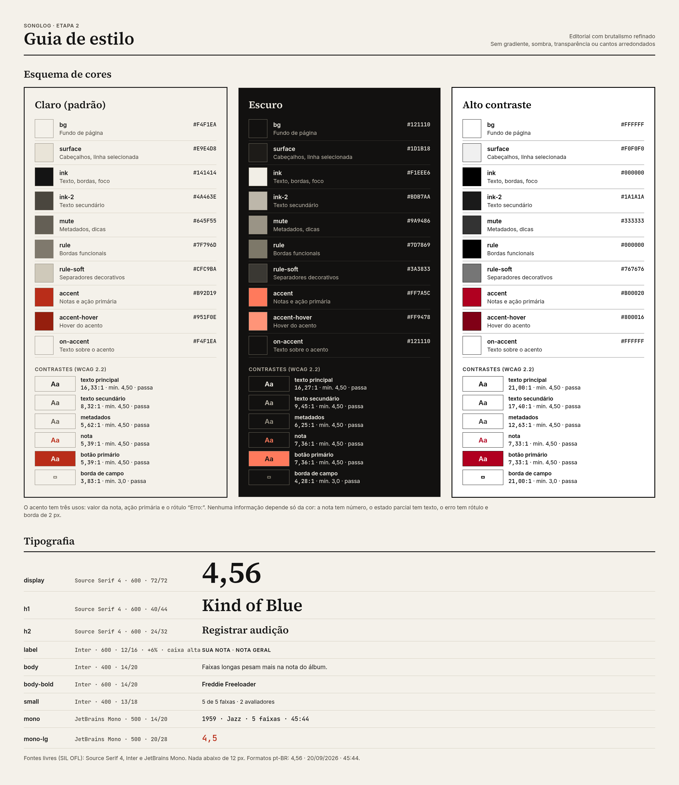

**Mesma tela nos três temas** (W4 Avaliação):

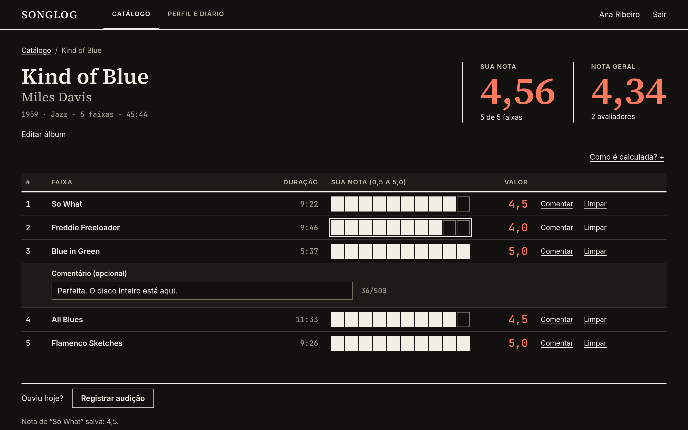

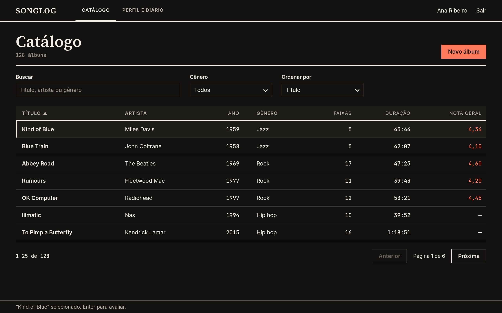

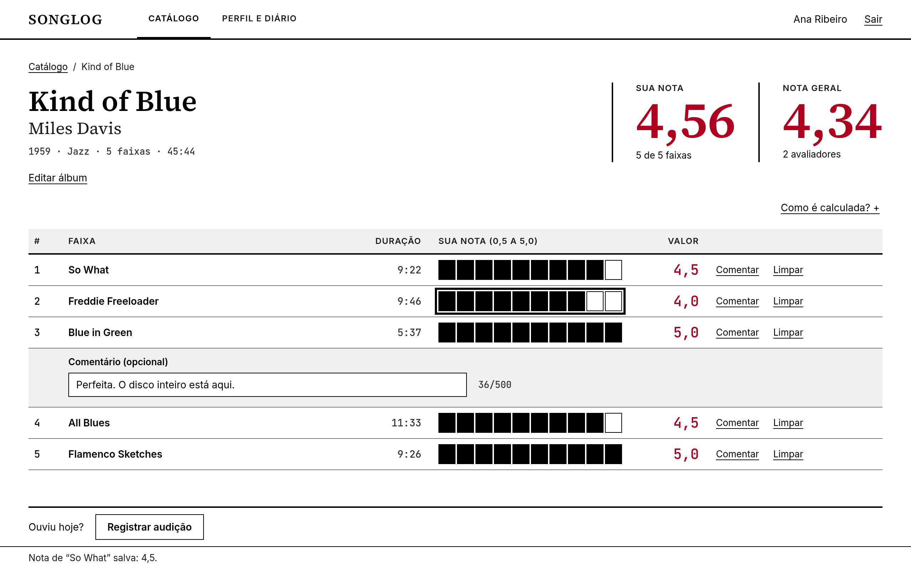

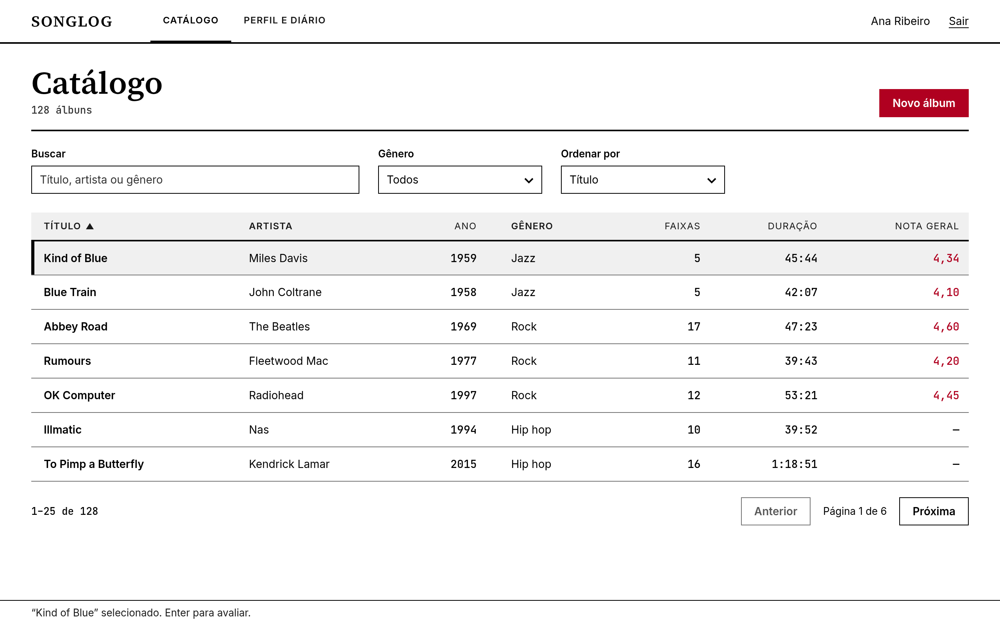

---

## 4. Tipografia

| Estilo | Fonte | Peso | Tam./Linha | Uso |
|---|---|---|---|---|
| `display` | Source Serif 4 | 600 | 72 / 72 | Nota do álbum em destaque |
| `h1` | Source Serif 4 | 600 | 40 / 44 | Título de página e do álbum |
| `h2` | Source Serif 4 | 600 | 24 / 32 | Seções (Diário, Faixas) |
| `label` | Inter | 600 | 12 / 16, +6%, caixa alta | Cabeçalhos de tabela, rótulos de bloco |
| `body` | Inter | 400 | 14 / 20 | Texto corrente, campos, botões |
| `body-bold` | Inter | 600 | 14 / 20 | Ênfase, botões primários |
| `small` | Inter | 400 | 13 / 18 | Dicas e mensagens de apoio |
| `mono` | JetBrains Mono | 500 | 14 / 20 | Durações, anos, contagens, notas em tabela |
| `mono-lg` | JetBrains Mono | 500 | 20 / 28 | Valor da nota ao lado da barra |

- **Nada abaixo de 12 px.** O único estilo de 12 px é `label`, em caixa alta e negrito, com contraste acima de 8:1.
- **Algarismos tabulares** em `mono` mantêm as colunas de nota, ano e duração alinhadas à direita.
- **Formatos pt-BR:** decimal com vírgula (`4,56`), data `dd/MM/aaaa`, duração `m:ss` ou `h:mm:ss`.
- **Notas:** faixa com 1 casa (`4,5`), média ponderada e nota geral com 2 casas (`4,56`).
- **Fontes embutidas.** Instale as fontes estáticas (TTF) dentro do projeto (`src/main/resources/fonts/`) e registre com `Font.createFont`. Não dependa de fontes do sistema: o computador do professor não as terá.

---

## 5. Grid, espaçamento e medidas

| Item | Valor |
|---|---|
| Janela padrão | 1280 × 800 px |
| Janela mínima | 1024 × 680 px |
| Barra superior | 56 px de altura, filete inferior de 2 px em `ink` |
| Barra de status | 32 px, no rodapé; mostra a última mensagem ("Álbum salvo.") e **não some sozinha** |
| Margem lateral | 40 px |
| Grid | 12 colunas, calha de 24 px (largura útil 1200 px, coluna de 78 px) |
| Escala de espaço | 4 · 8 · 12 · 16 · 24 · 32 · 48 · 64 |
| Altura de controle | 36 px (campos, botões, seletores) |
| Altura de linha de tabela | 44 px |
| Alvo mínimo de clique | 24 × 24 px, incluindo espaçamento |
| Raio de canto | 0 |
| Filetes | 1 px (estrutura), 2 px (cabeçalhos de seção, barra superior, bordas de diálogo) |

**Responsivo (janela redimensionada).** Abaixo de 1200 px de largura: esconder a coluna "Gênero" do Catálogo; abaixo de 1100 px, também "Duração". No W3 e no W5 as duas colunas empilham em uma. Nenhum conteúdo deve exigir rolagem horizontal a 1024 px.

---

## 6. Componentes (especificação para o Figma)

Crie cada componente como *Component Set* com as variantes indicadas. Nomeie como `Categoria/Nome/Estado`.

**Folha de componentes:**

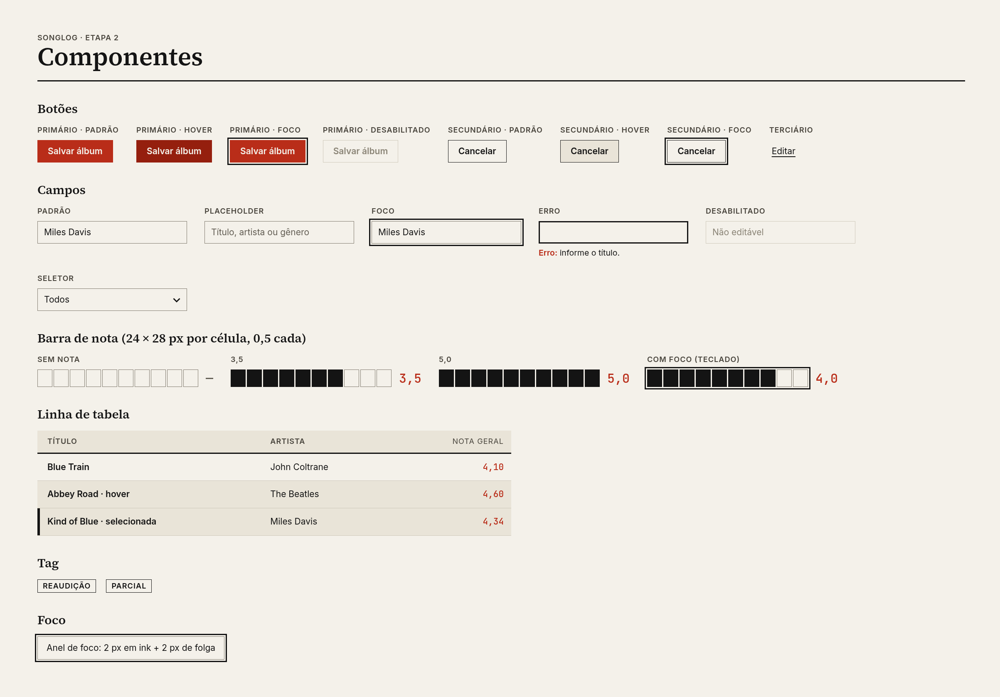

### Botão
| Variante | Aparência | Uso |
|---|---|---|
| Primário | Fundo `accent`, texto `on-accent`, `body-bold`, sem borda | Uma ação principal por tela |
| Secundário | Borda 1 px `ink`, fundo transparente, texto `ink` | Cancelar, Comentar, Remover, Excluir |
| Terciário | Texto `ink` sublinhado, sem borda | Editar, Excluir em linha, "Como é calculada?" |

Estados: `Padrão`, `Hover` (primário → `accent-hover`; secundário → fundo `surface`), `Pressionado`, `Foco`, `Desabilitado`. Altura 36 px, padding horizontal 16 px, largura mínima 88 px, rótulo em caixa mista (as caixas altas dos wireframes em texto servem só para destacar o botão primário).
**Não desabilite** um botão para "avisar" que o formulário está inválido: deixe clicável e mostre os erros.

### Campo de texto
Rótulo **sempre visível** acima (`label` ou `body-bold`), campo com borda 1 px `rule`, altura 36 px, texto `body`. Estados: `Padrão`, `Hover`, `Foco`, `Preenchido`, `Erro`, `Desabilitado`.
`Erro`: borda de 2 px em `ink` **e** a linha "Erro: …" abaixo (rótulo em `accent`, texto em `ink`). O placeholder nunca substitui o rótulo.
Obrigatório: asterisco após o rótulo e a legenda "* obrigatório" no fim do formulário.

### Seletor (combobox) e busca
Mesma aparência do campo, com "v" à direita. A busca do Catálogo filtra enquanto se digita (atraso de 250 ms) e informa o resultado ("12 álbuns") no cabeçalho.

### Linha de tabela
Altura 44 px; texto `body`; colunas numéricas em `mono`, alinhadas à direita. Cabeçalho: `label` sobre `surface`, filete inferior de 2 px `ink`; coluna ordenável mostra ▲/▼ e tem nome acessível "Ordenar por Título, crescente".
Estados: `Padrão`, `Hover` (fundo `surface`), `Selecionada` (fundo `surface` **e** barra de 4 px em `ink` à esquerda), `Foco` (anel).

### Barra de nota (RatingBar)
- 10 células de **24 × 28 px**, com 2 px de espaço, formando 260 px. Cada célula vale 0,5.
- Preenchida: `ink`. Vazia: borda 1 px `rule`. Ao passar o mouse, a barra pré-visualiza o valor e mostra o número ao lado, em `mono-lg` e `accent`.
- À direita, o valor em `mono-lg` `accent` (`4,5`) e o botão terciário "Limpar".
- Sem nota: barra vazia e valor "—".
- **Alternativa por teclado:** a barra é um controle de foco único. `←` `→` (ou `−` `+`) mudam ±0,5; digitar `4` ou `4,5` define o valor; `Enter` confirma e vai para a próxima faixa; `Delete` limpa; `Esc` desfaz. A barra nunca é o único meio de informar a nota: o número está sempre escrito.

### Bloco de nota (hero)
Rótulo `label` ("SUA NOTA"), valor `display` em `accent`, linha de apoio `body` ("5 de 5 faixas"). Blocos lado a lado, separados por filete vertical de 2 px `ink`.

### Tag
`REAUDIÇÃO`, `PARCIAL`: `label`, borda 1 px `ink`, sem preenchimento, padding 2 × 8 px. O significado está no texto, não na cor.

### Diálogo
`JDialog` modal, borda de 2 px `ink`, fundo `bg`, título em `h2`. Botão primário à direita, "Cancelar" à esquerda dele; o foco inicial vai para **Cancelar** em ações destrutivas. `Esc` cancela.

### Banner de sistema
Faixa no topo do conteúdo, fundo `surface`, filete de 2 px `ink` embaixo, prefixo "[!]" e a ação ("Tentar novamente"). Usado para falha de conexão com o MySQL. Não some sozinho.

### Estado vazio
Frase direta + a ação que resolve, alinhadas à esquerda, sem ilustração.

---

## 7. Wireframes

Cada wireframe está desenhado em texto com a proporção do frame de **1280 × 800** (cada caractere ≈ 13 px de largura). Convenções:

| Símbolo | Significado |
|---|---|
| `┌─┐` caixa | Campo de texto |
| `[ Rótulo ]` | Botão secundário |
| `█ RÓTULO █` | Botão primário (`accent`) |
| `█████░░░░░` | Barra de nota (cada `█`/`░` = 0,5) |
| `▌` | Barra de seleção de 4 px |
| `═` / `─` | Filete de 2 px / 1 px |
| `· · ·` | Separador decorativo (`rule-soft`) |

Os dados são ilustrativos. Só *Kind of Blue* usa os números do protótipo da Etapa 1 (nota 4,56, geral 4,34); confira durações e anos dos demais discos antes de mostrá-los em apresentação.

### W1 · Login / Cadastro  (RF01)

**Frame:** `W1 · Login`, 1280 × 800. Duas colunas: esquerda 7/12, direita 5/12.

```text
┌──────────────────────────────────────────────────────────────────────────────────────────────────┐
│                                                        │                                         │
│                                                        │                                         │
│                                                        │   ENTRAR                                │
│  SONGLOG                                               │   ─────────────────────────────────     │
│  ▀▀▀▀▀▀▀                                               │                                         │
│                                                        │   E-mail                                │
│                                                        │   ┌─────────────────────────────────┐   │
│                                                        │   │ ana@songlog.dev                 │   │
│  O disco é a                                           │   └─────────────────────────────────┘   │
│  soma das faixas.                                      │                                         │
│                                                        │   Senha                                 │
│                                                        │   ┌─────────────────────────────────┐   │
│  Avalie faixa por faixa.                               │   │ ••••••••••           Mostrar    │   │
│  Registre o que ouviu.                                 │   └─────────────────────────────────┘   │
│                                                        │                                         │
│                                                        │   ███████████████████████████████████   │
│                                                        │   █              ENTRAR             █   │
│                                                        │   ███████████████████████████████████   │
│                                                        │                                         │
│                                                        │   Não tem conta?  Criar conta           │
│                                                        │                                         │
│  v0.1.0                                                │                                         │
│                                                        │                                         │
└──────────────────────────────────────────────────────────────────────────────────────────────────┘
```

**Versão em alta fidelidade (tema claro):**

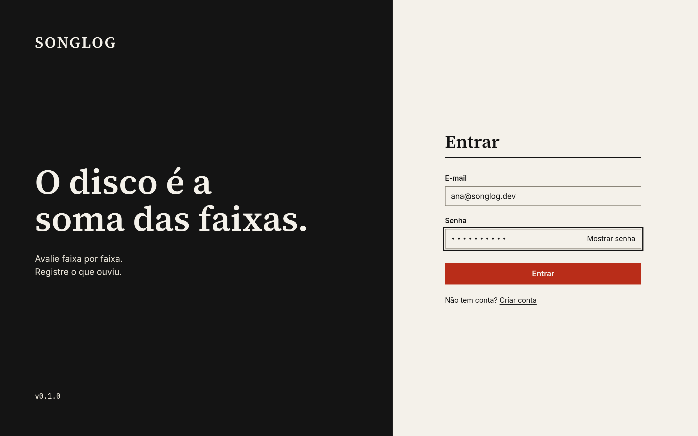

**Especificação**

- **Coluna esquerda:** fundo sólido `ink`, texto `bg` (contraste 16:1). Wordmark "SONGLOG" em Source Serif 4 Bold, caixa alta, 28 px, a 64 px do topo e da margem. Frase "O disco é a soma das faixas." em `h1` ampliado para 56/60, ancorada no centro vertical. Duas linhas de apoio em `body` na cor `surface` (contraste de 14,5:1 sobre `ink`). Versão em `small`, no rodapé.
- **Coluna direita:** fundo `bg`, formulário com 360 px de largura, centrado verticalmente.
- **Campos:** E-mail e Senha; a senha tem o botão terciário "Mostrar" com nome acessível "Mostrar senha".
- **Ação primária:** "Entrar". Link terciário "Criar conta" alterna o mesmo frame para o modo de cadastro.
- **Modo cadastro:** título "Criar conta", campos Nome, E-mail, Senha (dica permanente abaixo: "Mínimo de 8 caracteres") e Confirmar senha; primário "Criar conta"; link "Já tenho conta".
- **Teclado:** `Tab` percorre E-mail → Senha → Mostrar → Entrar → Criar conta. `Enter` em qualquer campo envia.
- **Erros:** "E-mail ou senha incorretos." (sem revelar qual dos dois). E-mail já usado: "Erro: este e-mail já está cadastrado." (RN11).

### W2 · Catálogo  (RF04)

**Frames:** `W2 · Catálogo` (1280 × 800) e `W2 · Catálogo / 1024` (1024 × 680, para conferir o reflow).

```text
┌──────────────────────────────────────────────────────────────────────────────────────────────────┐
│  SONGLOG       CATÁLOGO       PERFIL E DIÁRIO                               Ana Ribeiro    Sair  │
│                ▔▔▔▔▔▔▔▔                                                                          │
│══════════════════════════════════════════════════════════════════════════════════════════════════│
│                                                                                                  │
│  Catálogo                                                                   █ + NOVO ÁLBUM █     │
│  128 álbuns                                                                                      │
│  ──────────────────────────────────────────────────────────────────────────────────────────────  │
│  Buscar [ título, artista ou gênero…        ]      Gênero [ Todos      v] Ordenar [ Título   v]  │
│  ──────────────────────────────────────────────────────────────────────────────────────────────  │
│  TÍTULO                      ARTISTA           ANO   GÊNERO      FAIXAS   DURAÇÃO    NOTA GERAL  │
│──────────────────────────────────────────────────────────────────────────────────────────────────│
│ ▌Kind of Blue                Miles Davis       1959  Jazz           5      45:44        4,34     │
│· · · · · · · · · · · · · · · · · · · · · · · · · · · · · · · · · · · · · · · · · · · · · · · · · │
│  Blue Train                  John Coltrane     1958  Jazz           5      42:07        4,10     │
│· · · · · · · · · · · · · · · · · · · · · · · · · · · · · · · · · · · · · · · · · · · · · · · · · │
│  Abbey Road                  The Beatles       1969  Rock          17      47:23        4,60     │
│· · · · · · · · · · · · · · · · · · · · · · · · · · · · · · · · · · · · · · · · · · · · · · · · · │
│  Rumours                     Fleetwood Mac     1977  Rock          11      39:43        4,20     │
│· · · · · · · · · · · · · · · · · · · · · · · · · · · · · · · · · · · · · · · · · · · · · · · · · │
│  OK Computer                 Radiohead         1997  Rock          12      53:21        4,45     │
│· · · · · · · · · · · · · · · · · · · · · · · · · · · · · · · · · · · · · · · · · · · · · · · · · │
│  Illmatic                    Nas               1994  Hip hop       10      39:52           —     │
│· · · · · · · · · · · · · · · · · · · · · · · · · · · · · · · · · · · · · · · · · · · · · · · · · │
│  To Pimp a Butterfly         Kendrick Lamar    2015  Hip hop       16    1:18:51           —     │
│                                                                                                  │
│  1–25 de 128                                 [ < Anterior ]   Página 1 de 6   [ Próxima > ]      │
│                                                                                                  │
└──────────────────────────────────────────────────────────────────────────────────────────────────┘
```

**Versão em alta fidelidade (tema claro):**

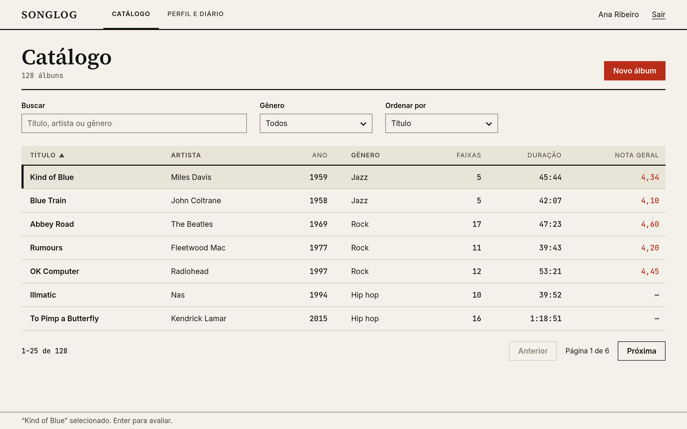

**Especificação**

- **Barra superior (todas as telas):** wordmark à esquerda; abas `CATÁLOGO` e `PERFIL E DIÁRIO`; nome do usuário e "Sair" à direita. Aba ativa: sublinhado de 2 px `ink` (não só negrito).
- **Cabeçalho da página:** `h1` "Catálogo"; abaixo, contagem em `mono` ("128 álbuns", muda com a busca); à direita o botão primário "+ NOVO ÁLBUM".
- **Filtros:** busca (largura 4 colunas), seletor de gênero, seletor de ordenação.
- **Tabela:** colunas TÍTULO, ARTISTA, ANO, GÊNERO, FAIXAS, DURAÇÃO, NOTA GERAL. Título em `body-bold`; números em `mono`, à direita. Nota geral em `accent`, ou "—" se ninguém avaliou por completo.
- **Linha selecionada:** barra de 4 px em `ink` e fundo `surface`.
- **Interação:** `↑` `↓` movem a seleção; `Enter` ou duplo clique abre W4; `F2` ou "Editar" no menu de contexto (`Shift+F10`) abre W3; `Delete` pede confirmação (W6c). `Ctrl+N` novo álbum; `Ctrl+F` foca a busca.
- **Rodapé:** "1–25 de 128" e paginação com "Anterior" / "Próxima" (25 linhas por página; sem rolagem infinita).
- **Vazio e carregando:** ver W6. Enquanto carrega, a tabela mostra a linha "Carregando…" (texto, sem animação).

### W3 · Álbum: cadastro e edição  (RF02, RF03)

**Frame:** `W3 · Álbum`, 1280 × 800. Página inteira, não modal: o formulário é longo e as faixas precisam de espaço.

```text
┌──────────────────────────────────────────────────────────────────────────────────────────────────┐
│  SONGLOG       CATÁLOGO       PERFIL E DIÁRIO                               Ana Ribeiro    Sair  │
│                ▔▔▔▔▔▔▔▔                                                                          │
│══════════════════════════════════════════════════════════════════════════════════════════════════│
│                                                                                                  │
│  Catálogo  /  Kind of Blue  /  Editar                                                            │
│  Editar álbum                                                                                    │
│  ──────────────────────────────────────────────────────────────────────────────────────────────  │
│                                      │                                                           │
│ DADOS DO ÁLBUM                       │  FAIXAS                                                   │
│                                      │                                                           │
│ Título *                             │  #   TÍTULO                       DURAÇÃO (m:ss)          │
│ ┌──────────────────────────────┐     │  ──────────────────────────────────────────────────────   │
│ │ Kind of Blue                 │     │  1   [ So What                 ] [  9:22] [ Remover ]     │
│ └──────────────────────────────┘     │  2   [ Freddie Freeloader      ] [  9:46] [ Remover ]     │
│ Artista *                            │  3   [ Blue in Green           ] [  5:37] [ Remover ]     │
│ ┌──────────────────────────────┐     │  4   [ All Blues               ] [ 11:33] [ Remover ]     │
│ │ Miles Davis                  │     │  5   [ Flamenco Sketches       ] [  9:26] [ Remover ]     │
│ └──────────────────────────────┘     │                                                           │
│ Ano *        Gênero                  │  [ + Adicionar faixa ]     Total: 5 faixas · 45:44        │
│ ┌────────┐   ┌─────────────────┐     │                                                           │
│ │ 1959   │   │ Jazz            │     │                                                           │
│ └────────┘   └─────────────────┘     │                                                           │
│                                      │                                                           │
│ * obrigatório                        │                                                           │
│                                                                                                  │
│  ──────────────────────────────────────────────────────────────────────────────────────────────  │
│  [ Excluir álbum ]                                              [ Cancelar ]   █ SALVAR ÁLBUM █  │
│                                                                                                  │
└──────────────────────────────────────────────────────────────────────────────────────────────────┘
```

**Versão em alta fidelidade (tema claro):**

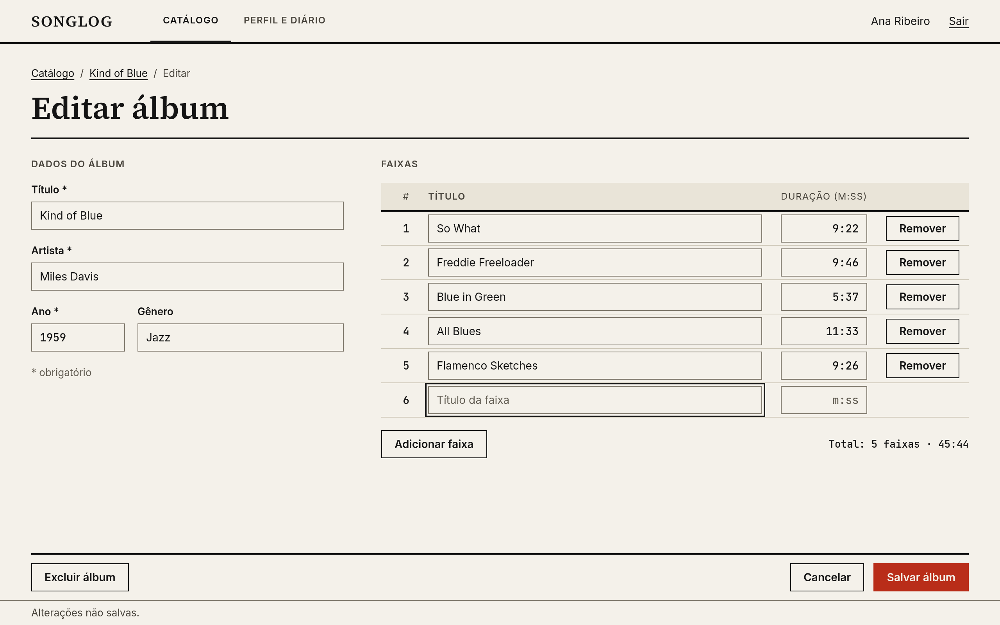

**Especificação**

- **Breadcrumb** `Catálogo / Novo álbum` (ou `Catálogo / Kind of Blue / Editar`). "Catálogo" é um link.
- **Coluna esquerda (4 colunas):** Título*, Artista*, Ano* (`mono`, 4 dígitos, entre 1877 e o ano seguinte, validação de `Album`) e Gênero (opcional).
- **Coluna direita (8 colunas):** editor de faixas. Colunas #, TÍTULO, DURAÇÃO no formato `m:ss`. O número é automático e sequencial (RN01) e se refaz ao remover.
- **Adicionar faixa:** o botão insere uma linha no fim e leva o foco para o título dela. `Enter` no campo de duração de uma linha adiciona a próxima linha.
- **Remover faixa:** a linha fica riscada e marcada "removida" até salvar; `Cancelar` descarta. Não há confirmação separada.
- **Total:** "Total: 5 faixas · 45:44" atualiza a cada edição.
- **Rodapé:** "Excluir álbum" (secundário) à esquerda, só na edição; "Cancelar" e "SALVAR ÁLBUM" (primário) à direita. `Ctrl+S` salva.
- **Validação:** ao sair do campo e ao salvar. Com mais de um erro, um resumo no topo lista todos e leva o foco ao primeiro campo inválido. Mensagens no W6b.
- **Título/artista/ano repetidos** (RN02): "Erro: já existe um álbum com este título, artista e ano."
- **Alterações não salvas:** `Cancelar` ou trocar de aba abre diálogo "Descartar alterações?".
- **Pendência de código:** a classe `Album` ainda não tem `removerFaixa`. Ao implementar, refazer a numeração para manter a RN01.

### W4 · Avaliação do álbum  (RF05, RF06, RF10)

**Frame:** `W4 · Avaliação`, 1280 × 800, e variantes `W4 · Parcial` e `W4 · Fórmula aberta`. É a tela central do produto.

```text
┌──────────────────────────────────────────────────────────────────────────────────────────────────┐
│  SONGLOG       CATÁLOGO       PERFIL E DIÁRIO                               Ana Ribeiro    Sair  │
│                ▔▔▔▔▔▔▔▔                                                                          │
│══════════════════════════════════════════════════════════════════════════════════════════════════│
│                                                                                                  │
│  Catálogo  /  Kind of Blue                                                                       │
│                                                                                                  │
│  Kind of Blue                                          SUA NOTA                    NOTA GERAL    │
│  Miles Davis                                           4,56                        4,34          │
│  1959 · Jazz · 5 faixas · 45:44                        5 de 5 faixas               2 avaliadores │
│                                                        [ Como é calculada? ]                     │
│                                                                                                  │
│  #   FAIXA                     DURAÇÃO   SUA NOTA (0,5 a 5,0)   VALOR                            │
│──────────────────────────────────────────────────────────────────────────────────────────────────│
│  1   So What                    9:22     [█████████░]           4,5    [ Comentar ] [ Limpar ]   │
│· · · · · · · · · · · · · · · · · · · · · · · · · · · · · · · · · · · · · · · · · · · · · · · · · │
│  2   Freddie Freeloader         9:46     [████████░░]           4,0    [ Comentar ] [ Limpar ]   │
│· · · · · · · · · · · · · · · · · · · · · · · · · · · · · · · · · · · · · · · · · · · · · · · · · │
│  3   Blue in Green              5:37     [██████████]           5,0    [ Comentar ] [ Limpar ]   │
│      Comentário (opcional) ┌──────────────────────────────────────────────────┐                  │
│                            │ Perfeita. O disco inteiro está aqui.             │36/500            │
│                            └──────────────────────────────────────────────────┘                  │
│· · · · · · · · · · · · · · · · · · · · · · · · · · · · · · · · · · · · · · · · · · · · · · · · · │
│  4   All Blues                 11:33     [█████████░]           4,5    [ Comentar ] [ Limpar ]   │
│· · · · · · · · · · · · · · · · · · · · · · · · · · · · · · · · · · · · · · · · · · · · · · · · · │
│  5   Flamenco Sketches          9:26     [██████████]           5,0    [ Comentar ] [ Limpar ]   │
│                                                                                                  │
│  Ouviu hoje?   [ Registrar audição ]                                                             │
│                                                                                                  │
└──────────────────────────────────────────────────────────────────────────────────────────────────┘
```

**Versão em alta fidelidade (tema claro):**

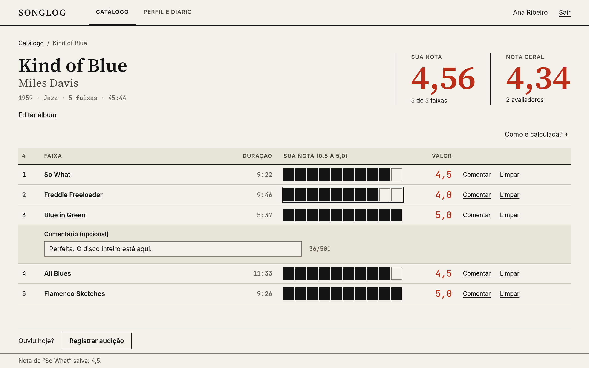

**Especificação**

- **Cabeçalho do álbum (esquerda, 6 colunas):** `h1` com o título, `h2` em `ink-2` com o artista, `mono` com "1959 · Jazz · 5 faixas · 45:44". Botão terciário "Editar álbum".
- **Blocos de nota (direita, 6 colunas):** "SUA NOTA" (`display`, `accent`) e "NOTA GERAL". Apoio abaixo de cada: "5 de 5 faixas" e "2 avaliadores". Filete vertical de 2 px entre eles.
- **Tabela de faixas:** #, FAIXA, DURAÇÃO, barra de nota, valor, "Comentar", "Limpar". A duração fica visível porque **é o peso** da faixa; um `mono` em `ink-2` discreto basta.
- **Comentário:** "Comentar" abre um campo de 500 caracteres logo abaixo da faixa, com contador "36/500". Faixas com comentário mostram "Editar comentário".
- **Rodapé:** "Ouviu hoje?" e o botão secundário "Registrar audição", que abre um diálogo curto (álbum já preenchido, data de hoje, comentário) e leva ao W5 se o usuário quiser.
- **Salvamento:** cada nota é salva ao confirmar (`Enter` ou clique), e a barra de status diz "Nota de 'So What' salva: 4,5." Sem botão "Salvar" global.
- **Nota da faixa fora da escala:** "Erro: a nota deve ir de 0,5 a 5,0, em passos de 0,5."
- **Atualização em tempo real:** ao mudar uma nota, o bloco "SUA NOTA" recalcula na hora.
- **Teclado:** `↑` `↓` percorrem faixas; `←` `→` ajustam ±0,5; digitar define; `Enter` confirma e vai para a próxima faixa; `Delete` limpa; `Esc` desfaz. O rodapé fixo nunca cobre a faixa com foco: ao focar, a lista rola com margem de 64 px.

**Estado parcial (RN06):**

```text
┌──────────────────────────────────────────────────────────────────────────────────────────────────┐
│  Kind of Blue                                          SUA NOTA                    NOTA GERAL    │
│  Miles Davis                                           4,81                        4,34          │
│  1959 · Jazz · 5 faixas · 45:44                        [ PARCIAL ] 2 de 5 faixas   2 avaliadores │
│  Avalie as 5 faixas para entrar na nota geral.                                                   │
└──────────────────────────────────────────────────────────────────────────────────────────────────┘
```

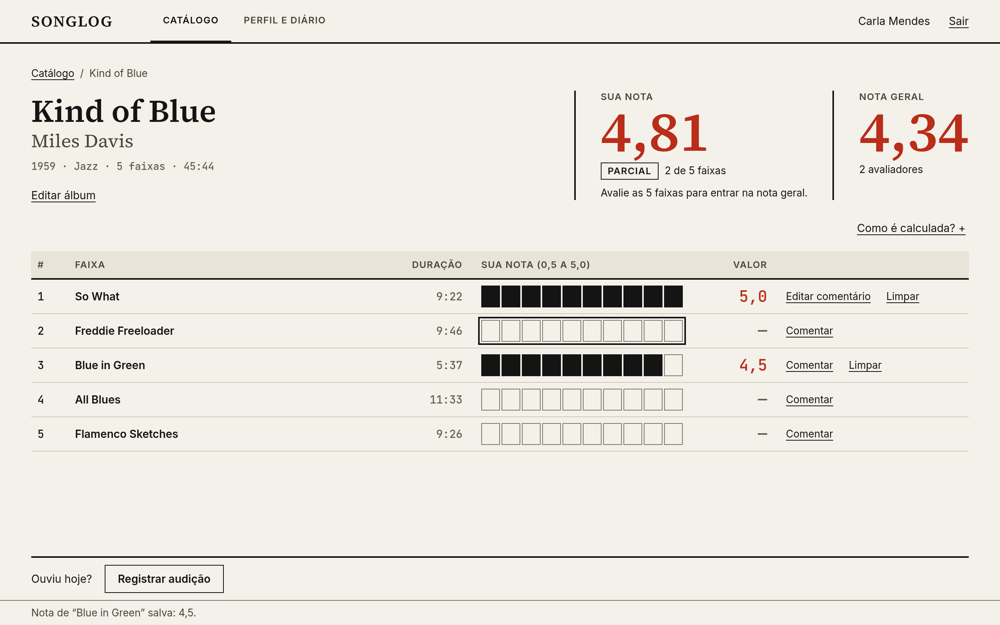

O rótulo `PARCIAL` é tag com texto. A frase de apoio explica o que falta. A nota parcial **não** entra na nota geral (RN07), e a interface diz isso.

**"Como é calculada?" aberto (RN05):**

```text
┌──────────────────────────────────────────────────────────────────────────────────────────────────┐
│  COMO A NOTA É CALCULADA                                                                         │
│  Nota = Σ (nota × duração) ÷ Σ (duração). Faixas longas pesam mais.                              │
│  (4,5×562 + 4,0×586 + 5,0×337 + 4,5×693 + 5,0×566) ÷ 2744 s  =  4,56                             │
│  Média simples: 4,60. A ponderada é 4,56 porque as duas faixas mais longas tiveram notas menores.│
└──────────────────────────────────────────────────────────────────────────────────────────────────┘
```

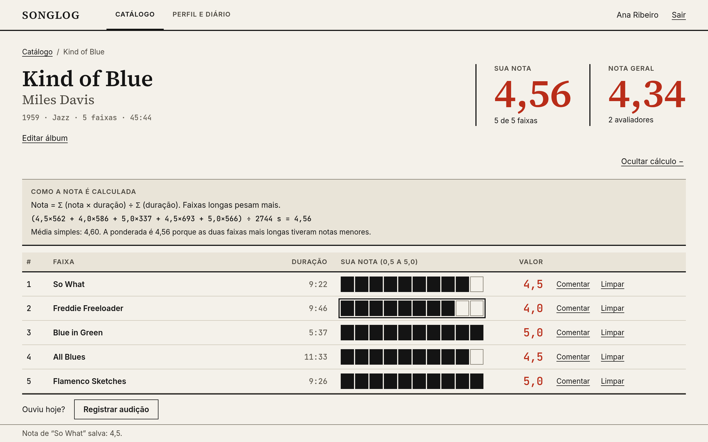

Abre embaixo dos blocos de nota, empurrando a tabela (não é popover). Mostra a conta com os números reais do álbum. Botão terciário passa a "Ocultar cálculo". Estado do disclosure é anunciado ("expandido/recolhido").

### W5 · Perfil e Diário  (RF07, RF08, RF09, RF10)

**Frame:** `W5 · Perfil e Diário`, 1280 × 800.

```text
┌──────────────────────────────────────────────────────────────────────────────────────────────────┐
│  SONGLOG       CATÁLOGO       PERFIL E DIÁRIO                               Ana Ribeiro    Sair  │
│                               ▔▔▔▔▔▔▔▔▔▔▔▔▔▔▔                                                    │
│══════════════════════════════════════════════════════════════════════════════════════════════════│
│                                                                                                  │
│  Ana Ribeiro                                                                                     │
│  Membro desde 12/03/2026                                                                         │
│                                                                                                  │
│──────────────────────────────────────────────────────────────────────────────────────────────────│
│ ÁLBUNS OUVIDOS          FAIXAS AVALIADAS        NOTA MÉDIA DADA         REAUDIÇÕES               │
│ 14                      96                      4,12                    3                        │
│──────────────────────────────────────────────────────────────────────────────────────────────────│
│                                                                                                  │
│ DIÁRIO                                                       │  REGISTRAR AUDIÇÃO                │
│                                                              │                                   │
│ SETEMBRO 2026                                                │  Álbum *                          │
│ 18/09  Kind of Blue — Miles Davis        [ REAUDIÇÃO ]       │  ┌──────────────────────────────┐ │
│        "Voltei só por Blue in Green."                        │  │ Kind of Blue — Miles Davis  v│ │
│        [ Editar ]  [ Excluir ]                               │  └──────────────────────────────┘ │
│                                                              │  Data *                           │
│ AGOSTO 2026                                                  │  ┌──────────────────────────────┐ │
│ 21/08  Kind of Blue — Miles Davis                            │  │ 20/09/2026                   │ │
│        "Primeira vez, de ponta a ponta."                     │  └──────────────────────────────┘ │
│        [ Editar ]  [ Excluir ]                               │  Comentário (opcional)            │
│                                                              │  ┌──────────────────────────────┐ │
│ [ Carregar meses anteriores ]                                │  │                              │ │
│                                                              │  └──────────────────────────────┘ │
│                                                              │  ████████████████████████████████ │
│                                                              │  █          REGISTRAR           █ │
│                                                              │  ████████████████████████████████ │
│                                                              │                                   │
│                                                              │  ÚLTIMAS AVALIAÇÕES               │
│                                                              │  Blue in Green      5,0           │
│                                                              │  So What            4,5           │
│                                                              │  All Blues          4,5           │
│                                                                                                  │
└──────────────────────────────────────────────────────────────────────────────────────────────────┘
```

**Versão em alta fidelidade (tema claro):**

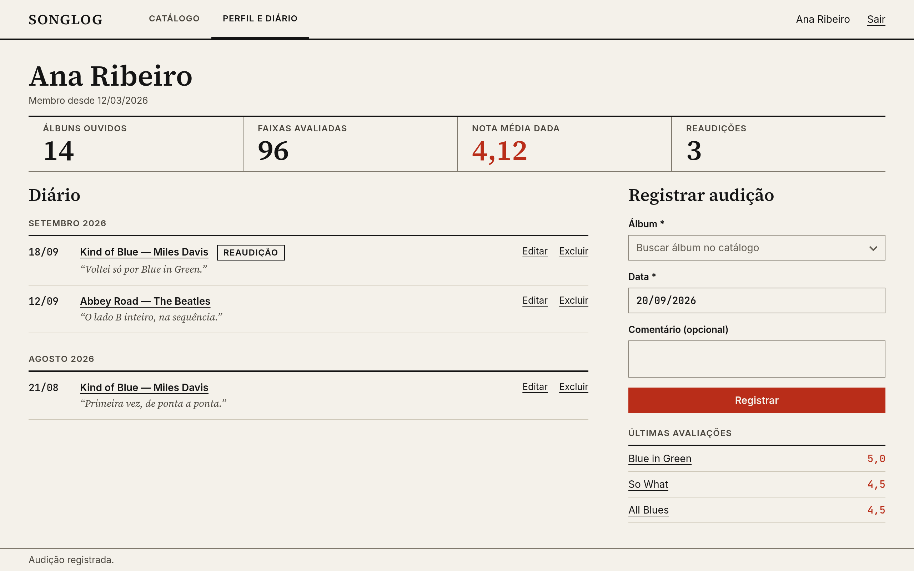

**Especificação**

- **Cabeçalho:** `h1` com o nome e "Membro desde 12/03/2026" em `ink-2`.
- **Faixa de estatísticas:** 4 colunas separadas por filetes, cada uma com `label` e o número em `h1` (40 px). Álbuns ouvidos, faixas avaliadas, nota média dada (`accent`), reaudições. Estatísticas são texto, não gráfico.
- **Diário (8 colunas):** agrupado por mês (`label` "SETEMBRO 2026"), do mais recente para o mais antigo (RF08). Cada entrada: data em `mono`, "Título — Artista" em `body-bold` (é um link para W4), tag `REAUDIÇÃO` se for o caso (RN09), comentário em itálico e ações "Editar" / "Excluir" **sempre visíveis** (terciário). Nada aparece só ao passar o mouse.
- **Registrar audição (4 colunas):** Álbum* (combobox com busca), Data* (hoje por padrão; não aceita futuro, RN10), Comentário. Ao registrar, a entrada surge no topo do diário, o foco vai para ela e a barra de status diz "Audição registrada."
- **Últimas avaliações:** 3 a 5 faixas, com nota em `mono` `accent`. Cada uma é link para W4.
- **Vazio:** "Seu diário está vazio. Registre o primeiro álbum que você ouviu."

### W6 · Estados e diálogos

**Frame:** `W6 · Estados`, com os quatro quadros abaixo lado a lado ou em sequência.

**a) Catálogo vazio**

```text
┌──────────────────────────────────────────────────────────────────────────────────────────────────┐
│                                                                                                  │
│  Catálogo                                                                   █ + NOVO ÁLBUM █     │
│  ──────────────────────────────────────────────────────────────────────────────────────────────  │
│                                                                                                  │
│  Nenhum álbum cadastrado ainda.                                                                  │
│  Cadastre o primeiro álbum para começar a avaliar faixa por faixa.                               │
│  [ + Cadastrar álbum ]                                                                           │
│                                                                                                  │
└──────────────────────────────────────────────────────────────────────────────────────────────────┘
```

**b) Erros de validação** (mostrando texto + estrutura, nunca só cor)

```text
┌──────────────────────────────────────────────────────────────────────────────────────────────────┐
│  Título *                                                                                        │
│  ┌────────────────────────────────────────┐                                                      │
│  │                                        │                                                      │
│  └────────────────────────────────────────┘                                                      │
│  Erro: informe o título do álbum.                                                                │
│                                                                                                  │
│  Duração *                                                                                       │
│  ┌────────────┐                                                                                  │
│  │ 9:75       │                                                                                  │
│  └────────────┘                                                                                  │
│  Erro: use o formato m:ss, com segundos de 00 a 59 (ex.: 9:22).                                  │
└──────────────────────────────────────────────────────────────────────────────────────────────────┘
```

**c) Confirmação de exclusão** (RN13: lista o que será perdido; foco inicial em "Cancelar")

```text
┌──────────────────────────────────────────────────────────────────────────────────────────────────┐
│                                                                                                  │
│      ┌────────────────────────────────────────────────────────────────────┐                      │
│      │ Excluir "Kind of Blue"?                                            │                      │
│      │                                                                    │                      │
│      │ Serão excluídas as 5 faixas, as 96 avaliações dessas faixas e as 2 │                      │
│      │ entradas de diário deste álbum. Esta ação não pode ser desfeita.   │                      │
│      │                                                                    │                      │
│      │                                   [ Cancelar ]   █ EXCLUIR ÁLBUM █ │                      │
│      └────────────────────────────────────────────────────────────────────┘                      │
│                                                                                                  │
└──────────────────────────────────────────────────────────────────────────────────────────────────┘
```

**d) Falha de conexão com o MySQL** (o banco roda local e pode estar desligado; a tela fica em leitura)

```text
┌──────────────────────────────────────────────────────────────────────────────────────────────────┐
│  [!] Não foi possível conectar ao banco de dados MySQL (localhost:3306).                         │
│  Verifique se o serviço MySQL está ativo e tente novamente.    [ Tentar novamente ]              │
│══════════════════════════════════════════════════════════════════════════════════════════════════│
│                                                                                                  │
│  (conteúdo da tela, somente leitura, até a conexão voltar)                                       │
│                                                                                                  │
└──────────────────────────────────────────────────────────────────────────────────────────────────┘
```

**Versão em alta fidelidade:**

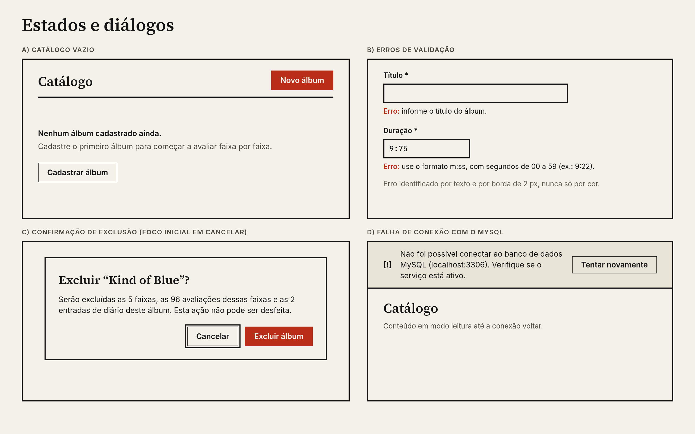

**Mensagens.** Em português, específicas, sem culpar o usuário e sem jargão técnico:

| Situação | Mensagem |
|---|---|
| Campo obrigatório vazio | "Erro: informe o título do álbum." |
| Duração inválida | "Erro: use o formato m:ss, com segundos de 00 a 59 (ex.: 9:22)." |
| Nota fora da escala | "Erro: a nota deve ir de 0,5 a 5,0, em passos de 0,5." |
| Data futura | "Erro: a data de audição não pode estar no futuro." |
| Sucesso | "Álbum salvo." · "Nota de 'So What' salva: 4,5." · "Audição registrada." |

---

## 8. Acessibilidade em uma aplicação desktop Java

**Meta.** As diretrizes WCAG 2.2 são escritas para a web, mas os critérios de percepção, operação e compreensão valem para software. Adotamos **nível AA como referência** (para software, a norma europeia EN 301 549 adota critérios equivalentes). Isso é uma meta de projeto, não uma certificação.

### 8.1 Teclado (o mais importante em desktop)

- **Tudo se opera sem mouse**, sem armadilha de foco (`Tab` entra e sai de qualquer componente).
- **Ordem de foco** igual à ordem de leitura: barra superior → conteúdo (esquerda → direita, cima → baixo) → rodapé. Implemente com `FocusTraversalPolicy` onde o padrão do Swing não bastar (o W3 e o W5 têm duas colunas).
- **Foco sempre visível** (WCAG 2.4.7): anel de 2 px em `ink`, com 2 px de folga na cor do fundo. Funciona sobre fundo claro, sobre `surface` e sobre o botão primário. No alto contraste, 3 px. O Look and Feel padrão do Swing desenha foco fraco; configure explicitamente.
- **Foco não encoberto** (2.4.11): o rodapé fixo do W4 e a barra de status não podem cobrir o item focado; role a lista com margem.
- **Atalhos globais:**

| Atalho | Ação |
|---|---|
| `Ctrl+1` / `Ctrl+2` | Ir para Catálogo / Perfil e Diário |
| `Ctrl+N` | Novo álbum |
| `Ctrl+F` | Focar a busca |
| `Ctrl+S` | Salvar formulário |
| `Enter` / `Esc` | Confirmar / cancelar (diálogos e edição de nota) |
| `Delete` | Excluir item selecionado (com confirmação) |
| `F1` | Lista de atalhos |

- **Mnemônicos** (`Alt` + letra sublinhada) nos botões e rótulos de campo: `setDisplayedMnemonicIndex` para sublinhar a letra certa.
- Atalhos de uma tecla só (sem modificador) valem apenas com o foco em uma lista/tabela, nunca globais.

### 8.2 Leitores de tela

- O Swing expõe a interface pela **Java Accessibility API** e, no Windows, pelo **Java Access Bridge**, que NVDA e JAWS usam. No Linux, o suporte com Orca é mais limitado. **Não testei leitores de tela** neste ambiente; o teste com NVDA precisa ser feito em uma máquina Windows antes de declarar conformidade.
- Todo componente com nome acessível: `getAccessibleContext().setAccessibleName(...)` e `setAccessibleDescription(...)`. Obrigatório para botões só com ícone, para a barra de ordenação da tabela e para a barra de nota.
- **Rótulo de campo associado:** `JLabel.setLabelFor(campo)`.
- **Barra de nota:** se for um componente customizado, implemente `Accessible` com `AccessibleRole.SLIDER` e `AccessibleValue` (mínimo 0,5, máximo 5,0, atual). A alternativa mais simples: usar um `JSpinner` numérico (0,5 a 5,0, passo 0,5) como controle real e desenhar as células apenas como visual.
- **Tabelas:** use `JTable` com cabeçalhos; renderizadores baseados em `JLabel` (texto real), nunca células pintadas à mão sem texto acessível.
- **Mensagens de status:** atualize o nome acessível da barra de status e, para erros de formulário, **mova o foco** ao primeiro campo com erro. Erros críticos usam diálogo, que é anunciado pelo sistema.

### 8.3 Cor e contraste

- Contrastes da seção 3.3 atendem 1.4.3 (texto ≥ 4,5:1) e 1.4.11 (componentes ≥ 3:1).
- **Cor nunca é o único sinal** (1.4.1): nota tem número; parcial tem tag com texto; erro tem "Erro:"; seleção tem barra; aba ativa tem sublinhado.
- **Alto contraste** como terceiro tema, em Preferências.
- Teste com simulação de daltonismo (protanopia/deuteranopia): a interface deve continuar legível porque o vermelho só reforça o que o texto já diz.

### 8.4 Texto e tamanho

- Nada abaixo de 12 px; corpo em 14 px.
- **Preferência "Tamanho do texto"** (100%, 125%, 150%): em Swing, aplique um fator de escala às fontes do Look and Feel; o FlatLaf também respeita a escala do sistema (HiDPI). Teste a 150% em 1366 × 768 (notebook comum de laboratório).
- Texto **truncado** (títulos longos com reticências) deve ter o conteúdo completo em outro lugar (na tela de detalhe). Dica de ferramenta (*tooltip*) é apoio, nunca a única fonte.
- **Idioma e formatos:** interface em pt-BR, `Locale` explícito para vírgula decimal e datas.

### 8.5 Alvos e formulários

- **Alvos ≥ 24 × 24 px** (WCAG 2.5.8); controles padrão têm 36 px, linhas 44 px, células da barra de nota 24 × 28 px.
- **Rótulos visíveis** em todos os campos; placeholder só como exemplo.
- **Erros** identificados no campo, em texto, com instrução de correção (3.3.1, 3.3.3).
- **Prevenção em ações destrutivas** (3.3.4): confirmação que diz o que será perdido; foco inicial em "Cancelar".
- **Sem limite de tempo**, sem animação, sem conteúdo que pisca. Mensagens de status permanecem até a próxima ação.
- **Ajuda consistente**: `F1` mostra os atalhos; "Como é calculada?" está no mesmo lugar sempre.

### 8.6 Linguagem e carga cognitiva

- Termos do domínio no mesmo sentido em toda a interface: *álbum, faixa, nota, avaliação, audição, diário*. Nunca "review", "rating" ou "log".
- "Ponderada" aparece pouco; o cálculo é explicado em linguagem direta e com o exemplo do próprio álbum.
- Máximo de **uma ação primária por tela**.
- Ações principais no mesmo lugar em todas as telas.

### 8.7 Como testar

| Teste | Como | Passa se |
|---|---|---|
| Só teclado | Desconectar o mouse; percorrer W1 a W6 | Todas as ações são possíveis; foco sempre visível; nenhuma armadilha |
| Contraste | Conferir cada par da seção 3.3 (script ou Figma "Contrast") | Todos ≥ 4,5:1 (texto) e ≥ 3:1 (bordas) |
| Zoom / escala | 150% e 200% em 1366 × 768 | Sem sobreposição, sem rolagem horizontal, botões visíveis |
| Leitor de tela | NVDA no Windows: percorrer login, avaliar uma faixa, registrar audição | Nome, função e valor de cada controle são anunciados |
| Inspeção da árvore | *Java Ferret* / *Java Monkey* (ferramentas do Java Access Bridge) | Nenhum componente interativo sem nome |
| Daltonismo | Filtro de simulação no Figma ou no SO | Nenhuma informação se perde |
| Erros | Provocar cada mensagem da seção 7 | Texto específico, foco no campo, sem perder o que foi digitado |

---

## 9. Roteiro para montar no Figma

> **Arquivo já gerado no Figma:** [SongLog - Etapa 2 (UX/UI)](https://www.figma.com/design/mJEz6Im9a5ICNKt9penidG). Tem 3 páginas: **00 · Fundamentos e componentes** (paletas dos 3 temas com contraste, tipografia, 10 estilos de texto, variáveis de cor e de espaço, e os componentes Botão, Campo, Tag, Barra de nota, Barra superior e Barra de status); **01 · Telas** (W1 a W6, mais as variantes parcial e fórmula aberta do W4, com 10 links de protótipo e ponto de partida no W1); **02 · Temas** (W2 e W4 em escuro e alto contraste).
>
> **Limites do plano gratuito (Starter), que moldaram o arquivo:** máximo de 3 páginas e 1 modo por coleção de variáveis. Por isso os temas são 3 coleções de cor com os mesmos nomes de token, e a página de temas usa cópias dos frames com as instâncias separadas dos componentes (para poder trocar as cores). As variáveis de espaço e tamanho existem, mas as telas ainda usam valores fixos nelas. Em um plano Professional ou Educacional, o ideal é unir as 3 coleções em uma só com 3 modos.

O passo a passo abaixo continua valendo para refinar o arquivo.

**Atalho.** As telas já estão prontas em `design/exports/*.png` (referência visual) e `design/telas/*.html` (fonte editável, com CSS variável por tema). Coloque os PNGs numa página `06 · Referência` do Figma e redesenhe por cima usando componentes e variáveis, ou teste um plugin de importação de HTML (por exemplo, o *html.to.design*, de terceiros; confira se atende antes de depender dele).

**1. Arquivo e páginas** (crie exatamente nesta ordem)

| Página | Conteúdo |
|---|---|
| `00 · Fundamentos` | Variáveis, estilos de texto, paleta, tipografia, grid |
| `01 · Componentes` | Component Sets da seção 6 |
| `02 · Wireframes` | W1–W6 em baixa fidelidade (cinza + tinta), só estrutura |
| `03 · Telas` | W1–W6 em alta fidelidade, tema claro |
| `04 · Temas` | W4 e W2 nos temas escuro e alto contraste |
| `05 · Protótipo` | Fluxo interativo |

**2. Variáveis (página 00)**
- Importe `design-tokens.json` (plugin *Tokens Studio* ou crie à mão). Coleção **Color** com 3 modos: `Claro`, `Escuro`, `Alto contraste`, com os 10 tokens da seção 3.1.
- Coleção **Space** (4 a 64), coleção **Size** (alturas de controle e linha) e **Radius = 0**.
- Todo preenchimento e contorno usa variável; nenhum hexadecimal solto.

**3. Estilos de texto**
Um estilo por linha da tabela da seção 4 (`display`, `h1`, `h2`, `label`, `body`, `body-bold`, `small`, `mono`, `mono-lg`). Instale as três fontes no seu computador antes (Google Fonts). Ative **números tabulares** nos estilos `mono`.

**4. Grid**
Frames de 1280 × 800: *Layout grid* de colunas, 12 colunas, margem 40, calha 24. Adicione uma grade de 8 px para alinhamento vertical.

**5. Componentes (página 01)**
Construa com *Auto Layout*. Ordem sugerida: Botão → Campo → Linha de tabela → Barra de nota → Tag → Bloco de nota → Diálogo → Banner. Cada estado da seção 6 vira uma variante. Confira o foco em todos: anel de 2 px em `ink` com 2 px de folga.

**6. Wireframes (página 02)**
Redesenhe cada desenho da seção 7 sobre o frame de 1280 × 800. Use só retângulos e texto; ainda sem cor de acento. Valide a estrutura e a hierarquia com alguém antes de passar para a alta fidelidade.

**7. Alta fidelidade (página 03)**
Troque as caixas cinza pelos componentes, aplique as variáveis e os estilos. Use os dados de exemplo da seção 7. Crie as variantes de 1024 × 680 para W2 e W4.

**8. Temas (página 04)**
Duplique W2 e W4, altere o **modo** da variável na coleção Color (`Escuro`, `Alto contraste`). Se algo quebrar, é porque tem cor solta.

**9. Protótipo (página 05)**
Conecte estes fluxos:
1. W1 → W2 (Entrar).
2. W2 → W4 (linha) → W2 (breadcrumb).
3. W2 → W3 (Novo álbum) → W2 (Salvar/Cancelar).
4. W4 → diálogo "Registrar audição" → W5.
5. W2 → W6c (Excluir) → W2.

**10. Entrega**
Exporte em PNG a página 03 (para o relatório) e deixe o arquivo do Figma com link de leitura. Para a implementação, exporte `design-tokens.json` atualizado.

---

## 10. Ponte para a implementação em Swing

- **Look and Feel:** [FlatLaf](https://www.formdev.com/flatlaf/) (dependência Maven `com.formdev:flatlaf`). Crie um tema próprio a partir de `FlatLightLaf` com um arquivo `.properties`.
- Ponto de partida do tema (**conferir os nomes na documentação da versão do FlatLaf que usar**):

```properties
@background = #F4F1EA
@foreground = #141414
@accentColor = #B92D19
Component.arc = 0
Button.arc = 0
TextComponent.arc = 0
Component.focusWidth = 2
Component.borderColor = #7F796D
Table.rowHeight = 44
```

- **Fontes:** carregue os TTF de `src/main/resources/fonts/` com `Font.createFont(Font.TRUETYPE_FONT, ...)`, registre em `GraphicsEnvironment` e defina a fonte padrão em `UIManager`.
- **Temas:** classes `TemaClaro`, `TemaEscuro` e `TemaAltoContraste`, um `.properties` cada, com os mesmos nomes de token de `design-tokens.json`. Troca em tempo de execução com `FlatLaf.setup(...)` + `FlatLaf.updateUI()`.
- **Estrutura do pacote `view`:** `TelaLogin`, `TelaCatalogo`, `TelaAlbum`, `TelaAvaliacao`, `TelaPerfilDiario`, e `componentes/` com `BarraDeNota`, `TagRotulo`, `BlocoDeNota`.
- **Regra de camadas (RNF03):** as telas não contêm regra de negócio. O cálculo da nota vem de `NotaService`; mensagens de validação vêm das exceções do modelo, já em português.

---

## 11. Checklist de fechamento da Etapa 2

**Feito**
- [x] Paleta (3 temas) e tipografia definidas, com contrastes calculados
- [x] Guia de estilo e folha de componentes em imagem
- [x] Wireframes em texto (W1–W6) e telas em alta fidelidade (PNG e HTML)
- [x] Variantes: avaliação parcial, fórmula aberta, tema escuro e alto contraste
- [x] Acessibilidade documentada para desktop Java
- [x] Estudo de UX: personas, jornadas, avaliação heurística e plano de teste (seção 12)

- [x] Arquivo no Figma com fundamentos, 6 componentes, 8 telas, 4 telas de tema e protótipo (link na seção 9)

**Pendente (só você consegue fazer)**
- [ ] Abrir o arquivo no Figma, conferir e ajustar; definir o compartilhamento do link (visualização) para quem vai avaliar
- [ ] Executar o teste de usabilidade (seção 12.5) com 3 a 5 pessoas e registrar os resultados
- [ ] Teste "só teclado" e teste com NVDA quando as telas Swing existirem

---

## 12. Estudo de UX: personas, jornadas, heurísticas e plano de teste

Esta seção é o **estudo de usabilidade** que sustenta as decisões das telas. As personas partem dos três perfis de usuário do documento de projeto (Amante de música, Crítico casual, Catalogador) e são **hipóteses de trabalho**, não resultado de pesquisa. O que ainda precisa ser feito com pessoas reais está no plano de teste (12.5) e marcado como pendente.

### 12.1 Personas

| | **Ana Ribeiro** · Amante de música | **Bruno Tavares** · Crítico casual | **Carla Mendes** · Catalogadora |
|---|---|---|---|
| Perfil | 24 anos, estudante. Ouve cerca de 10 álbuns por mês e tem opinião forte sobre faixas específicas. | 31 anos, analista. Gosta de escrever sobre o que ouve, sem ser profissional. | 28 anos, bibliotecária. Mantém o acervo de discos da família e o organiza com método. |
| Objetivo principal | Registrar a nota de cada faixa sem interromper a escuta e ver por que o disco ficou com aquela nota. | Guardar comentários e ter um histórico do que pensou de cada disco ao longo do tempo. | Ter um catálogo completo e correto, sem álbuns duplicados nem dados faltando. |
| Frustrações hoje | Uma nota única por álbum esconde as faixas que ela mais gostou. Streaming não tem diário. | Comentários ficam espalhados em redes sociais e notas de celular. | Planilhas quebram: durações em formatos diferentes, nomes de artista escritos de várias formas. |
| Uso mais frequente | Avaliação (W4) e Diário (W5) | Diário (W5) e comentários (W4) | Catálogo (W2) e edição de álbum (W3) |
| Habilidade com computador | Alta, atalhos de teclado. | Média, mouse. | Média, teclado e mouse. |
| Implicação de design | Fluxo de avaliação 100% por teclado (W4). | Comentários visíveis e editáveis no diário. | Validação clara no cadastro, detecção de duplicidade (RN02). |

### 12.2 Jornadas

**J1 · Avaliar um disco recém-ouvido (Ana)**

| Etapa | O que faz | Pensa / sente | Ponto de atrito | Resposta do design |
|---|---|---|---|---|
| 1. Encontrar | `Ctrl+F` e digita "kind" | "Quero achar rápido." | Busca lenta ou sem retorno | Filtro enquanto digita; contagem de resultados no cabeçalho |
| 2. Abrir | `Enter` na linha | "Vou dar as notas." | Não saber como abrir | Barra de status: "Enter para avaliar" |
| 3. Avaliar | Digita a nota, `Enter`, próxima faixa | "Não quero tirar a mão do teclado." | Precisar do mouse para cada faixa | Barra de nota operável por teclado; foco avança sozinho |
| 4. Entender | Olha a nota do álbum | "Por que 4,56 e não 4,60?" | Cálculo opaco | "Como é calculada?" com a conta do próprio álbum |
| 5. Registrar | "Registrar audição" | "Quero guardar que ouvi hoje." | Ter de trocar de tela | Diálogo curto com álbum e data já preenchidos |

**J2 · Cadastrar um álbum (Carla)**

| Etapa | O que faz | Pensa / sente | Ponto de atrito | Resposta do design |
|---|---|---|---|---|
| 1. Iniciar | "Novo álbum" | "Vou começar pelo básico." | Formulário longo assusta | Dados à esquerda, faixas à direita, tudo visível |
| 2. Preencher | Título, artista, ano, gênero | "Tomara que não duplique." | Cadastro repetido | Erro de duplicidade nomeando o álbum existente |
| 3. Faixas | Adiciona faixa, digita `m:ss` | "Preciso das 12 durações certas." | Duração em formato errado | Máscara `m:ss` e erro específico ("segundos de 00 a 59") |
| 4. Salvar | `Ctrl+S` | "Salvou mesmo?" | Falta de confirmação | Barra de status: "Álbum salvo." |

**J3 · Rever o que ouviu (Bruno)**

| Etapa | O que faz | Pensa / sente | Ponto de atrito | Resposta do design |
|---|---|---|---|---|
| 1. Abrir o diário | Aba "Perfil e Diário" | "O que eu disse sobre esse disco?" | Histórico misturado | Agrupado por mês, mais recente primeiro |
| 2. Reconhecer | Lê as entradas | "Já ouvi esse antes." | Não distinguir reaudição | Tag "REAUDIÇÃO" com texto |
| 3. Corrigir | "Editar" no comentário | "Escrevi errado." | Ações escondidas | "Editar" e "Excluir" sempre visíveis |

### 12.3 Avaliação heurística (Nielsen)

Autoavaliação do projeto, feita por quem o desenhou. **Deve ser repetida por outra pessoa** antes de ser tomada como validação.

| # | Heurística | Como o projeto responde | Risco a observar no teste |
|---|---|---|---|
| 1 | Visibilidade do estado do sistema | Barra de status persistente; "PARCIAL 2 de 5"; contagem de resultados | Usuário não olhar a barra de status |
| 2 | Correspondência com o mundo real | "Faixa", "álbum", "audição", "diário"; nota de 0,5 a 5,0 como no cinema/música | "Ponderada" pode soar técnico |
| 3 | Controle e liberdade | `Esc` desfaz; `Cancelar` descarta; remover faixa só vale ao salvar | Sem "desfazer" depois de salvar |
| 4 | Consistência e padrões | Mesma barra superior, ação primária sempre no mesmo lugar, mesmos rótulos | Aba "Perfil e Diário" reúne duas coisas |
| 5 | Prevenção de erros | Validação por campo; data futura, nota fora da escala e duração inválida recusadas | Formato `m:ss` pode ser digitado errado |
| 6 | Reconhecer em vez de lembrar | Rótulos visíveis; atalhos na barra de status e no `F1` | Atalhos exigem aprendizado |
| 7 | Flexibilidade e eficiência | Teclado completo para quem é rápido; mouse para quem prefere | Descobrir os atalhos |
| 8 | Design estético e minimalista | Uma ação primária por tela; um só acento; sem decoração | Pouca "pista visual" para iniciantes |
| 9 | Ajudar a reconhecer e corrigir erros | "Erro:" + instrução + exemplo (`9:22`) | Mensagens longas em campos estreitos |
| 10 | Ajuda e documentação | `F1`; "Como é calculada?" no ponto de uso | Ajuda não ser encontrada |

### 12.4 Análise comparativa (conceitual)

Comparação de **abordagens**, sem teste dos produtos nesta etapa.

| Abordagem | O que faz bem | Lacuna que o SongLog atende |
|---|---|---|
| Letterboxd (cinema) | Diário e nota como hábito social; visual limpo, focado no filme | É para filmes; o análogo por faixa não existe |
| Serviços de streaming | Ouvir e descobrir música | Em geral, não há nota por faixa nem diário de audição |
| Planilhas e apps de catálogo pessoal | Total controle dos dados | Sem cálculo de nota ponderada, sem validação, interface pesada |

### 12.5 Plano de teste de usabilidade (a executar)

**Status: pendente.** Nenhum teste com pessoas foi feito. O plano abaixo é para ser aplicado sobre o protótipo clicável do Figma.

- **Objetivo:** verificar se pessoas conseguem avaliar um disco, cadastrar um álbum e localizar uma entrada do diário sem ajuda, e onde travam.
- **Participantes:** 5 pessoas (colegas de turma servem), incluindo ao menos 1 que use muito o teclado e 1 que prefira o mouse.
- **Método:** teste moderado individual, ~20 min, protótipo clicável, pensando em voz alta. O moderador **observa e não ajuda**.
- **Roteiro:** (1) explicar que o teste avalia a interface, não a pessoa; (2) pedir autorização para anotar; (3) tarefas T1–T5; (4) perguntas finais.

| Tarefa | Enunciado dado à pessoa | Sucesso quando | Meta |
|---|---|---|---|
| T1 | "Você acabou de ouvir *Kind of Blue*. Dê sua nota a cada faixa." | As 5 faixas têm nota | ≥ 80% concluem sem ajuda; ≤ 2 min |
| T2 | "Descubra por que a nota do álbum é 4,56 e não 4,60." | Abre "Como é calculada?" e explica o peso da duração | ≥ 80% concluem |
| T3 | "Cadastre o álbum *Blue Train*, de John Coltrane, 1958, com 5 faixas." | Álbum salvo com as 5 durações válidas | ≥ 80% concluem; ≤ 4 min |
| T4 | "Registre que você ouviu *Abbey Road* ontem." | Entrada no diário com a data correta | ≥ 90% concluem |
| T5 | "Ache o comentário que você escreveu sobre *Kind of Blue* em agosto e edite." | Comentário editado | ≥ 80% concluem |

**Medidas por tarefa:** concluiu (sim/não/com ajuda), tempo, número de erros, nota de dificuldade de 1 (muito difícil) a 7 (muito fácil) logo após cada tarefa (*Single Ease Question*). **No fim:** "o que foi mais confuso?" e "o que faltou?".

**Ficha de registro (copiar uma por participante):**

| Tarefa | Concluiu? | Tempo | Erros | Dificuldade (1–7) | Observações |
|---|---|---|---|---|---|
| T1 | | | | | |
| T2 | | | | | |
| T3 | | | | | |
| T4 | | | | | |
| T5 | | | | | |

**Como agir sobre os resultados:** problema visto por 2 ou mais participantes vira ajuste obrigatório no Figma; problema visto por 1 é anotado e reavaliado. Registrar antes e depois de cada ajuste.
