# SongLog — Etapa 3: telas e interações em Java

> **Documento histórico.** Descreve a entrega da Etapa 3, com dados em memória. Desde a Etapa 4 os dados vivem no MySQL e o programa é executado como descrito em [`etapa-4-banco-de-dados.md`](etapa-4-banco-de-dados.md); trechos abaixo sobre `Contexto.emMemoria()`, `NotaService.notaGeral` e `java -jar songlog-0.3.0.jar` não valem mais.

Aplicação desktop em **Java Swing**, sem dependências externas (só o JDK 17 ou mais novo), seguindo o projeto de interfaces da Etapa 2. Nesta etapa os dados vivem **em memória**; o MySQL entra trocando apenas as classes de `repositorio`.

## 1. Como abrir e executar

**NetBeans:** *File → Open Project* → escolha a pasta `SongLog` (projeto Maven) → **F6** (ou botão *Run*). A classe principal é `br.com.songlog.Main`.

**Terminal** (JDK 17+ e Maven):

```bash
mvn package
java -jar target/songlog-0.3.0.jar
```

Não precisa de internet nem de instalação extra: as fontes (Source Serif 4, Inter e JetBrains Mono, licença livre OFL) estão embutidas em `src/main/resources/fonts`.

## 2. Usuários de demonstração

| E-mail | Senha | Perfil |
|---|---|---|
| `ana@songlog.dev` | `songlog123` | Avaliou *Kind of Blue* por completo |
| `bruno@songlog.dev` | `songlog123` | Avaliou *Kind of Blue* por completo |
| `carla@songlog.dev` | `songlog123` | Avaliou só 2 de 5 faixas (mostra o estado **parcial**) |

Também dá para criar uma conta em "Criar conta". *Kind of Blue* usa os dados reais do exemplo do projeto (nota da Ana 4,56; nota geral 4,34); os outros 7 álbuns são fictícios.

## 3. O que cada tela faz

| Tela | Classe | Requisitos | Interações |
|---|---|---|---|
| Login / Criar conta | `TelaLogin` | RF01 | Validação por campo, "Mostrar senha", erro genérico para credenciais erradas, hash de senha fora da thread da interface |
| Catálogo | `TelaCatalogo` | RF04 | Busca enquanto digita (sem acentos), filtro de gênero, ordenação por coluna ou pelo seletor, paginação, abrir com Enter/duplo clique, F2 edita, Delete exclui, menu de contexto |
| Álbum (novo/editar) | `TelaAlbum` | RF02, RF03 | Formulário + editor de faixas (m:ss), total ao vivo, validação ao sair do campo e ao salvar, remover só vale ao salvar, aviso de alterações não salvas, excluir com confirmação |
| Avaliação | `TelaAvaliacao` | RF05, RF06, RF10 | Barra de nota por mouse ou teclado, "Sua nota" e nota geral recalculadas ao vivo, estado parcial, "Como é calculada?", comentário por faixa, "Limpar", registrar audição |
| Perfil e Diário | `TelaPerfilDiario` | RF07 a RF10 | Estatísticas, diário por mês, registrar/editar/excluir audição, últimas avaliações |
| Preferências | `Dialogos.preferencias` | RNF06 | Tema claro, escuro ou alto contraste; texto a 100%, 125% ou 150% (a janela se reconstrói) |

**Navegação:** abas *Catálogo* e *Perfil e Diário*; `Ctrl+1` e `Ctrl+2` (atalho global); a Avaliação abre a partir de um álbum; o nome do usuário abre as Preferências; `F1` lista os atalhos.

### Teclado

| Atalho | Ação |
|---|---|
| `Ctrl+N` / `Ctrl+F` / `Ctrl+S` | Novo álbum / buscar / salvar o formulário |
| `Enter` / `F2` / `Delete` | Abrir / editar / excluir o álbum selecionado |
| `←` `→` ou `+` `−` | Nota da faixa ±0,5 |
| `4` ou `4,5` | Digitar a nota da faixa |
| `↑` `↓` / `Enter` / `Delete` / `Esc` | Faixa anterior ou próxima / próxima faixa / limpar nota / voltar ao valor inicial |

## 4. Regras de negócio no código

| Regra | Onde está |
|---|---|
| RN01 álbum com N ≥ 1 faixas, numeração sequencial | `CatalogoService.validar`, `Album.adicionarFaixa` / `removerFaixa` |
| RN02 título + artista + ano únicos | `CatalogoService.validar`, `AlbumRepositorio.existeDuplicado` |
| RN03 nota de 0,5 a 5,0 em passos de 0,5 | `Avaliacao.validarNota`, `BarraDeNota` |
| RN04 uma avaliação por usuário e faixa | `Usuario.avaliar` |
| RN05 nota do álbum ponderada pela duração | `NotaService.notaDoUsuario` |
| RN06 avaliação parcial identificada | `TelaAvaliacao` (tag PARCIAL) |
| RN07 nota geral só com avaliações completas | `NotaService.notaGeral` |
| RN08/RN09 diário e reaudição | `Usuario.registrarAudicao` |
| RN10 data de audição não pode ser futura | `PerfilService` |
| RN11 e-mail único, senha só como hash | `AutenticacaoService`, `SenhaUtil` (PBKDF2) |
| RN12 duração maior que zero | `Tempo.interpretar`, `Faixa` |
| RN13 exclusão em cascata | `CatalogoService.excluir` |

## 5. Arquitetura

As telas (`view`) só montam a interface e chamam os serviços; não têm regra de negócio nem acesso a dados. Os serviços (`service`) usam os repositórios pela **interface** (`AlbumRepositorio`, `UsuarioRepositorio`). Para usar o MySQL basta implementar essas duas interfaces com JDBC e trocar o `Contexto.emMemoria()`; as telas não mudam.

## 6. Como foi verificado

Foram feitos dois programas de teste, em `src/test/java`, que rodam **sem monitor** (modo headless do Java):

```bash
mvn test-compile
java -Djava.awt.headless=true -cp target/classes:target/test-classes br.com.songlog.TesteDeInteracao
java -Djava.awt.headless=true -cp target/classes:target/test-classes br.com.songlog.CapturaDeTelas
```

- **`TesteDeInteracao`** monta as telas reais, dispara cliques e teclas e confere o modelo: **44 verificações passaram** (login, busca, abrir/editar, notas por teclado e mouse, recálculo, parcial, fórmula, comentário, cadastro com erros, duplicidade, remoção de faixa em cascata, diário, os 3 temas em 100% e 150%).
- **`CapturaDeTelas`** desenha as telas em PNG (2560 × 1600). As imagens de `docs/telas` vêm dela.

**O que ainda não foi verificado:** a `Janela` em execução real (foco do teclado, diálogos modais, atalhos globais) só pôde ser conferida pela leitura do código, porque os testes não abrem janela. Rode o programa uma vez no NetBeans e percorra as 5 telas antes de entregar.

## 7. Limitações conhecidas

- Os dados não persistem: ao fechar o programa volta tudo ao estado inicial (esperado até a etapa do banco).
- O Swing tem suporte limitado a leitores de tela; os componentes têm nome acessível e a barra de nota expõe `AccessibleValue`, mas NVDA não foi testado.
- A janela mínima é 1024 × 680. Com texto a 150% a coluna Duração da avaliação é ocultada para caber (a duração aparece na dica do título).
- A aparência foi conferida nas imagens geradas; o desenho do anel de foco só pode ser visto com a janela em uso.

## 8. Capturas de tela

Geradas pelo programa `CapturaDeTelas` (tema claro, 1280 × 800, salvo indicação).

| | |
|---|---|
| 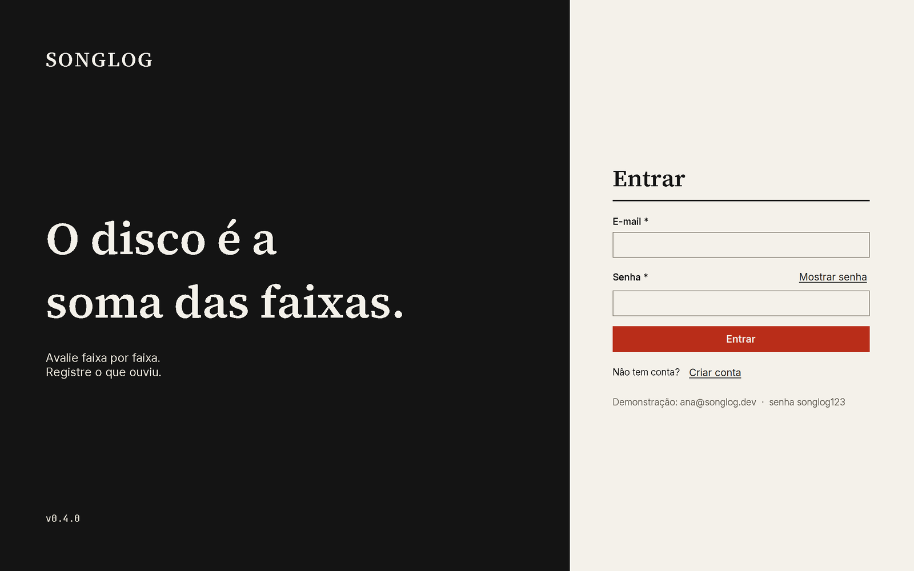 | 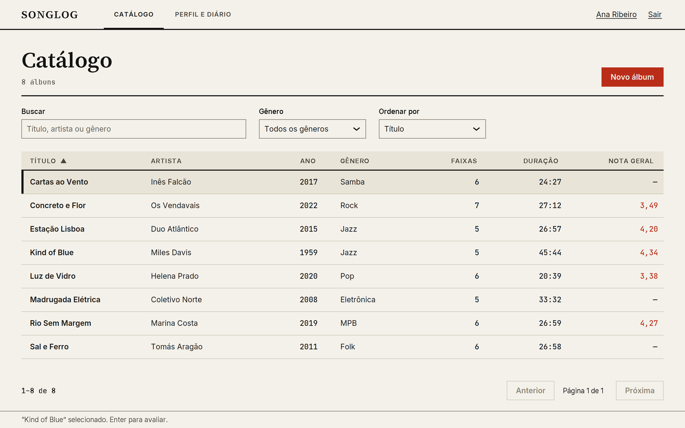 |
| 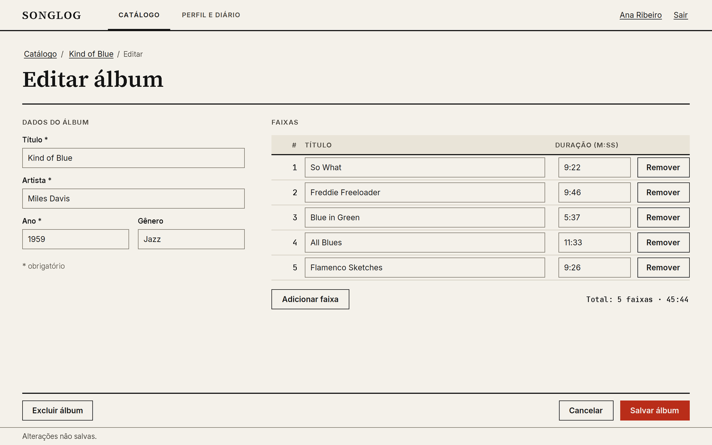 | 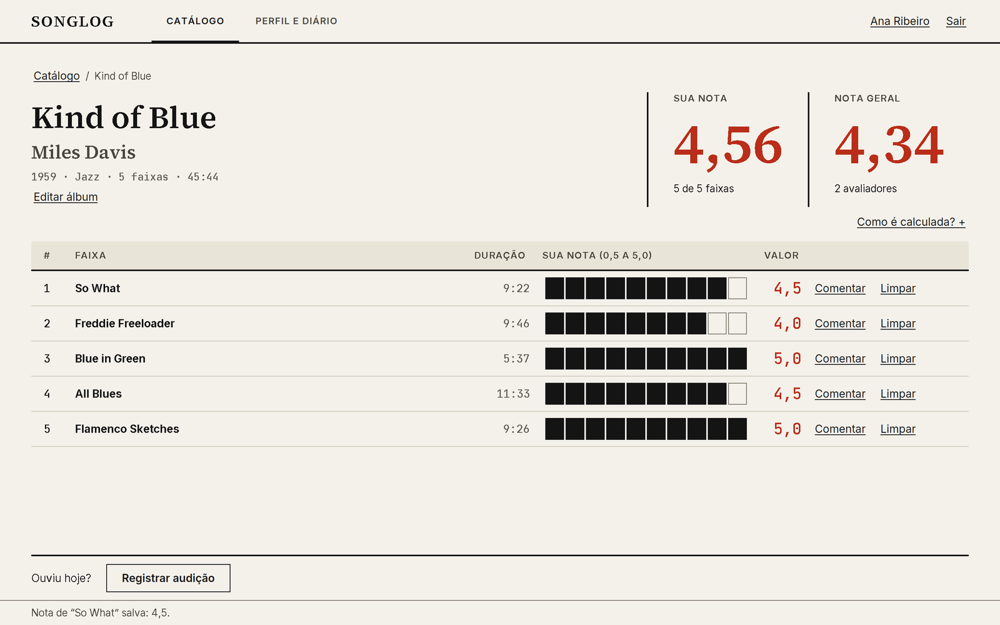 |
| 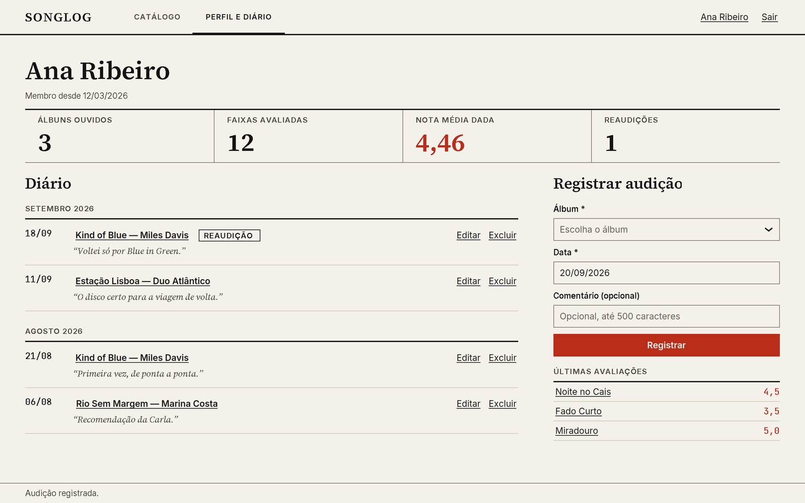 | 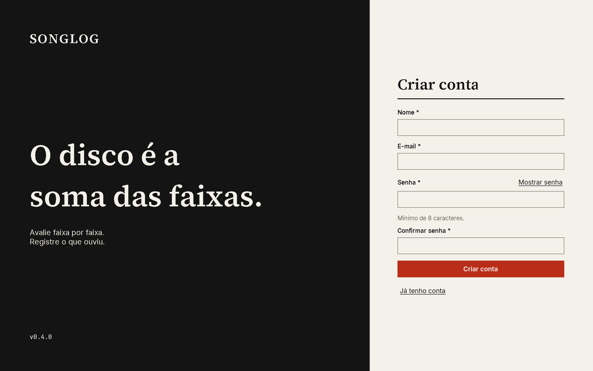 |
| 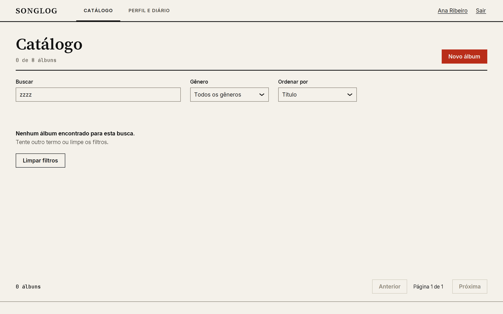 | 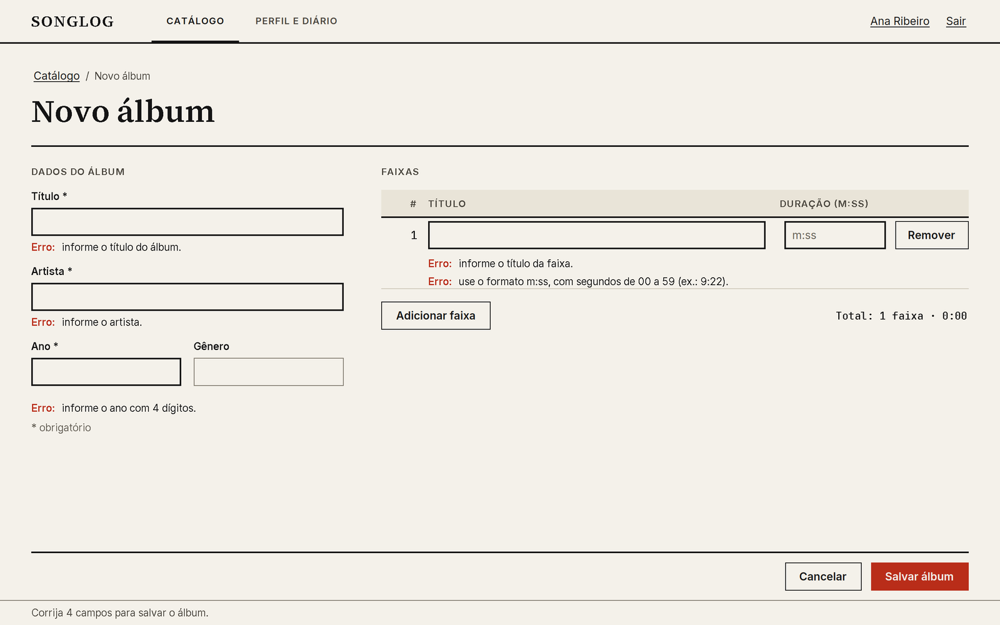 |
| 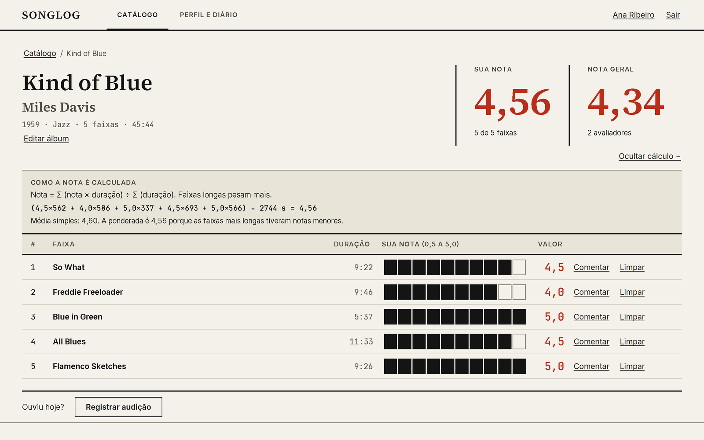 | 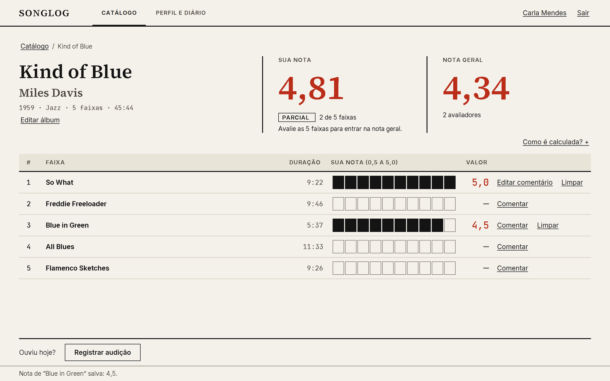 |
| 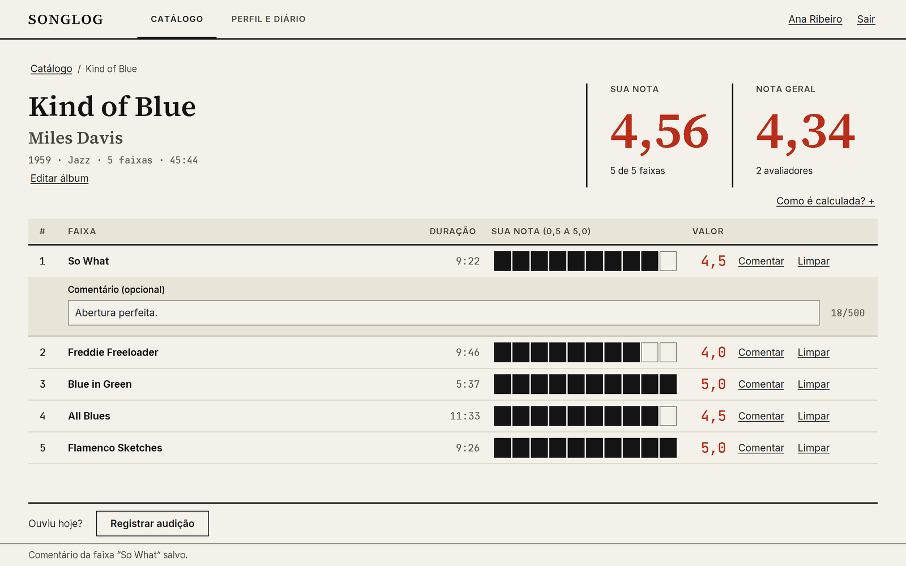 | 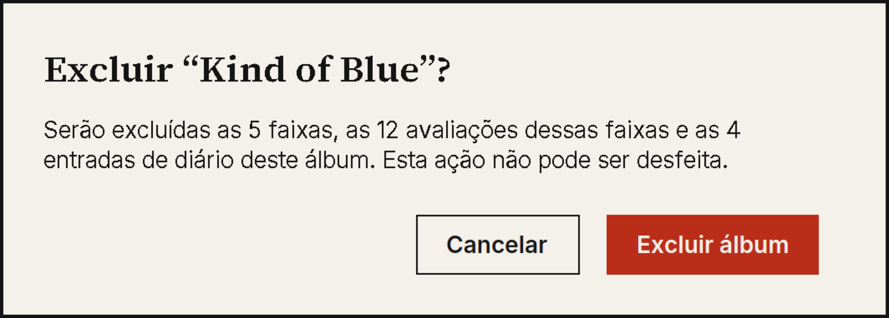 |
| 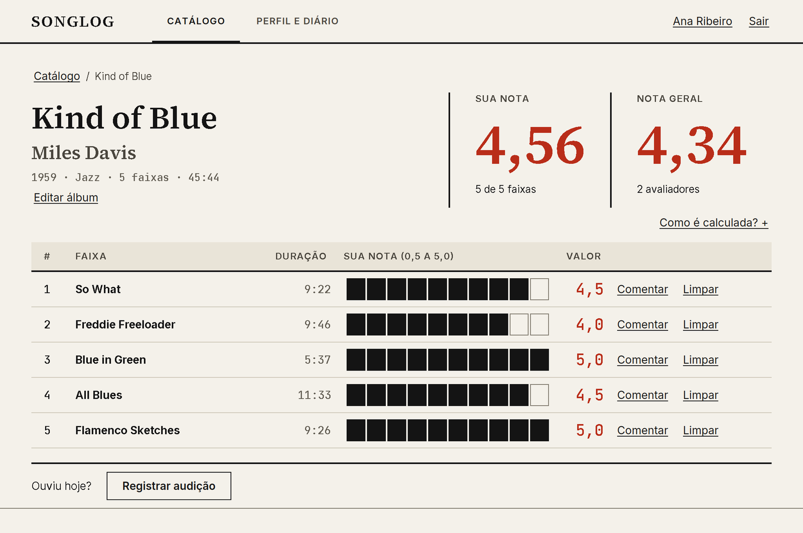 | 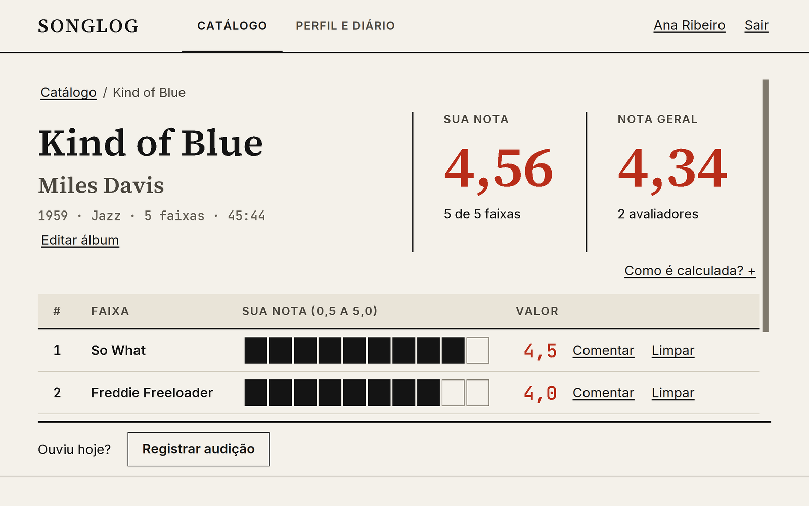 |
| 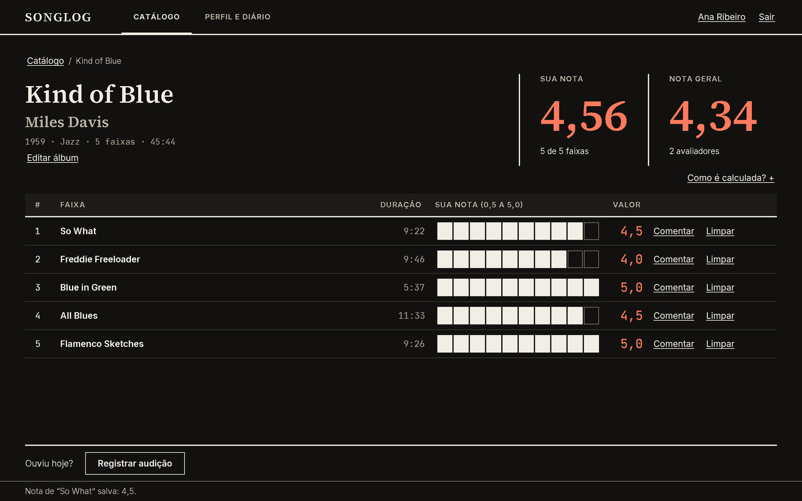 | 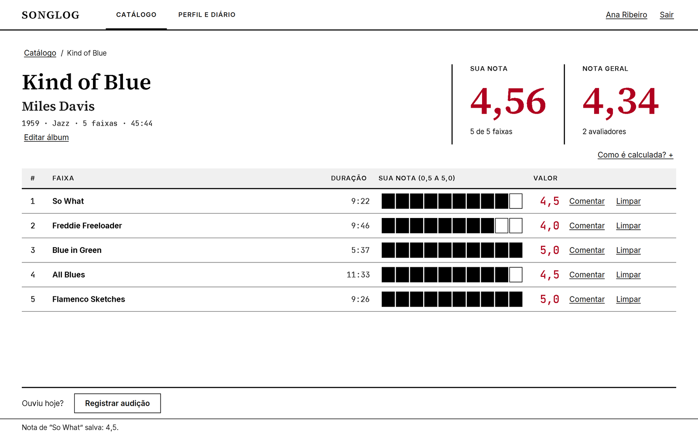 |
