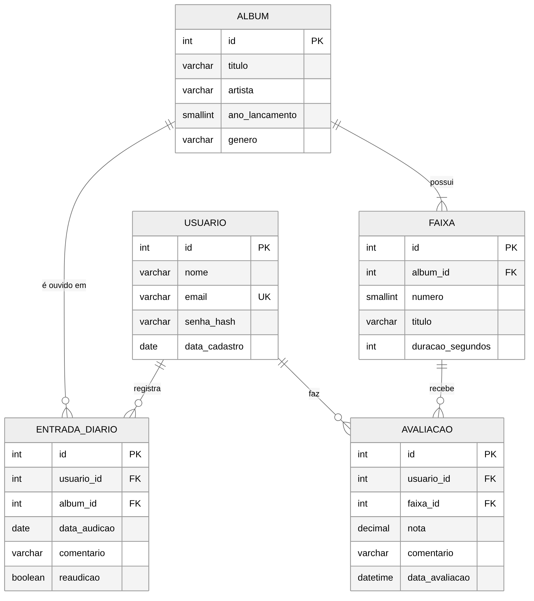
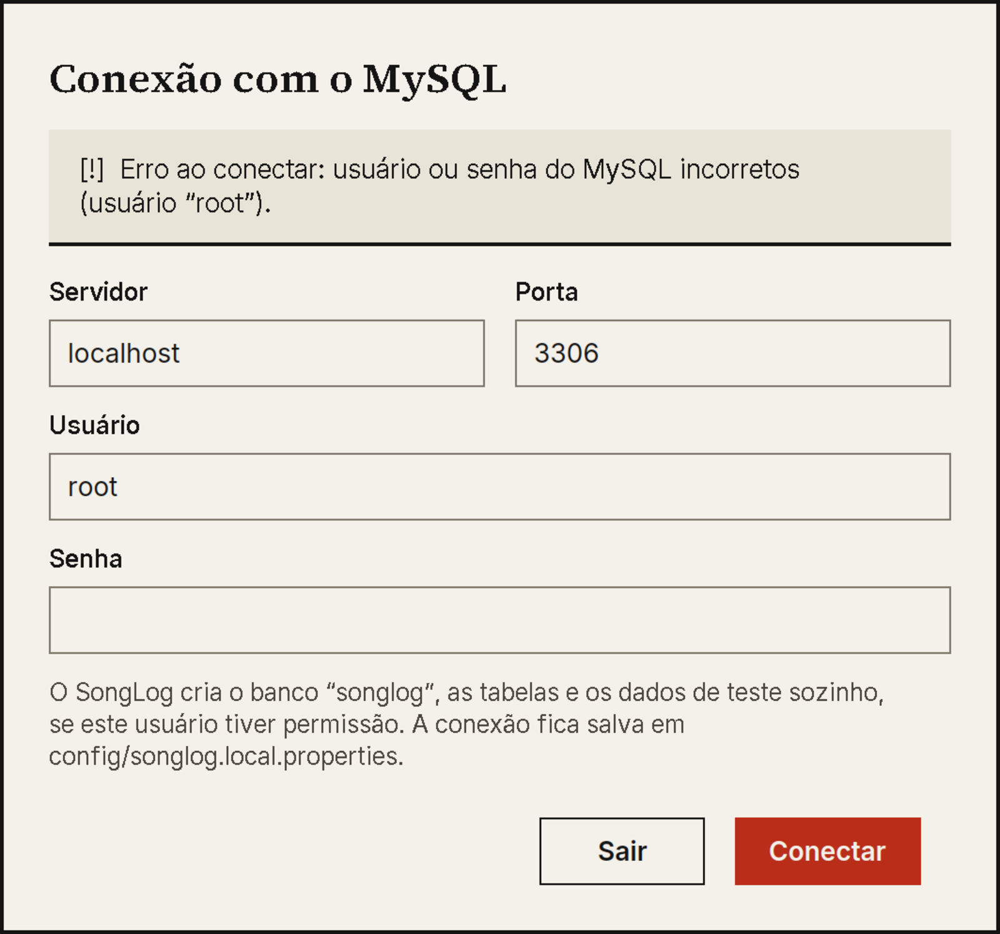

# SongLog — Etapa 4: banco de dados MySQL e acesso a dados

Nesta etapa o SongLog deixou de guardar tudo em memória: os dados vivem num banco **MySQL 8**, acessado por **JDBC** (MySQL Connector/J 8.4). Todo código provisório da Etapa 3 (repositórios em memória, dados de demonstração criados em Java, protótipo de console) foi **removido** e substituído por código definitivo.

## 1. Como executar

**Pré-requisito:** um servidor MySQL 8.0 ou mais novo rodando (a mesma instalação que o MySQL Workbench usa) e o JDK 17 ou mais novo. Maven baixa o driver JDBC na primeira compilação, então precisa de internet nessa vez.

**NetBeans:** *File → Open Project* → pasta `SongLog` → **F6**.

**Terminal:**

```bash
mvn package
java -jar target/songlog-0.4.0.jar
```

O `.jar` gerado já leva o driver, as fontes e os scripts SQL dentro (`maven-shade-plugin`).

**Na primeira execução** o programa tenta conectar em `localhost:3306` com o usuário `root` e senha vazia. Se o seu MySQL tem senha (o normal), abre a janela **Conexão com o MySQL**: digite servidor, porta, usuário e senha. Ao conectar, o programa:

1. cria o banco `songlog` se ele não existir;
2. cria as tabelas e as views (`banco/01-esquema.sql`) se ainda não existirem;
3. carrega os dados de teste (`banco/02-dados-iniciais.sql`) **apenas se** as tabelas de usuários e álbuns estiverem vazias;
4. salva a conexão digitada em `config/songlog.local.properties` (arquivo local, fora do Git), e nas próximas vezes entra direto.

Login de demonstração: `ana@songlog.dev` / `songlog123` (também `bruno@` e `carla@`, mesma senha).

### Onde a conexão é configurada

Cada fonte sobrescreve a anterior:

| Ordem | Fonte | Uso |
|---|---|---|
| 1 | valores padrão no código | localhost, 3306, banco `songlog`, usuário `root` |
| 2 | `config/songlog.properties` | valores do projeto, sem senha |
| 3 | `config/songlog.local.properties` | criado pela janela de conexão; contém a senha; está no `.gitignore` |
| 4 | variáveis `SONGLOG_DB_HOST`, `_PORTA`, `_NOME`, `_USUARIO`, `_SENHA` | servidores e automação |
| 5 | `-Dsonglog.db.host=...` (e `porta`, `nome`, `usuario`, `senha`) | linha de comando |

A senha nunca fica no código nem no repositório.

## 2. O banco de dados



Arquivos em `banco/`:

| Arquivo | Conteúdo |
|---|---|
| `01-esquema.sql` | `CREATE DATABASE`, 5 tabelas, restrições, índice e 2 views |
| `02-dados-iniciais.sql` | 3 usuários, 8 álbuns, 46 faixas, 49 avaliações, 6 entradas de diário |
| `03-consultas-exemplo.sql` | 6 consultas para experimentar no Workbench (catálogo com nota geral, nota por usuário com PARCIAL, faixa a faixa, diário, estatísticas do perfil, exclusão em cascata dentro de uma transação com `ROLLBACK`) |
| `diagrama-er.png` / `.mmd` | diagrama entidade-relacionamento e o código-fonte dele |

**No MySQL Workbench:** abra `01-esquema.sql` e `02-dados-iniciais.sql` (*File → Open SQL Script*) e execute na ordem, ou deixe o programa criar tudo. Para ver o diagrama do próprio Workbench, use *Database → Reverse Engineer* sobre o banco `songlog`. O arquivo `.mwb` não foi gerado neste ambiente.

### Regras de negócio no banco

O banco garante, por conta própria, o que o programa também valida. Assim, dado inválido não entra nem por outra ferramenta.

| Regra | Como o banco garante |
|---|---|
| RN02 álbum único por título + artista + ano | `uk_album`; a *collation* `utf8mb4_unicode_ci` ignora maiúsculas e acentos, então "Estação Lisboa" e "estacao lisboa" colidem |
| RN03 nota de 0,5 a 5,0 em passos de 0,5 | `DECIMAL(2,1)` + `ck_avaliacao_nota` + `ck_avaliacao_passo` |
| RN04 uma nota por usuário e faixa | `uk_avaliacao_usuario_faixa` (o programa faz *upsert*: `INSERT ... ON DUPLICATE KEY UPDATE`) |
| RN07 nota geral só com avaliações completas | view `vw_nota_geral_album` (usa `vw_nota_usuario_album`, que calcula a média ponderada pela duração) |
| RN11 e-mail único | `uk_usuario_email` |
| RN12 duração maior que zero | `ck_faixa_duracao` |
| RN13 exclusão em cascata | `ON DELETE CASCADE` em `faixa`, `avaliacao` e `entrada_diario` |
| RN01, RN10 (álbum com ao menos uma faixa; data de audição não futura) | só no programa (`CatalogoService`, `PerfilService`): o MySQL não tem como exigir "ao menos uma linha filha" nem `CURDATE()` num `CHECK` |

A nota ponderada é calculada em dois lugares de propósito: em Java (`NotaService.notaDoUsuario`, para atualizar a tela ao vivo enquanto o usuário arrasta a nota) e em SQL (as views, para o catálogo e a nota geral). Um teste confere que os dois dão o mesmo número (Kind of Blue: 4,348578717201166 nos dois).

## 3. Arquitetura do acesso a dados

```
view  →  service  →  repositorio (interfaces)  →  repositorio.jdbc  →  banco  →  MySQL
```

| Camada | Classes | Papel |
|---|---|---|
| `banco` | `Configuracao`, `Banco`, `ScriptSql`, `BancoException` | lê a configuração, abre conexões, cria banco/tabelas/dados na primeira vez, traduz erros do MySQL para mensagens em português |
| `repositorio` | `AlbumRepositorio`, `UsuarioRepositorio`, `AvaliacaoRepositorio`, `DiarioRepositorio` | contratos: o que os serviços precisam, sem SQL |
| `repositorio.jdbc` | `AlbumJdbc`, `UsuarioJdbc`, `AvaliacaoJdbc`, `DiarioJdbc` | implementação com `PreparedStatement` |
| `service` | `CatalogoService`, `AvaliacaoService`, `PerfilService`, `AutenticacaoService`, `NotaService`, `Contexto` | regras de negócio; `Contexto` liga tudo |

**Decisões:**

- **Grava no banco primeiro, depois no objeto em memória.** Se o MySQL recusar (ou cair), a tela continua igual ao banco. As telas recarregam o usuário logado do banco ao entrar em Avaliação e Perfil.
- **Só `PreparedStatement`.** Nenhuma consulta concatena texto do usuário. Na busca do catálogo, `%`, `_` e `\` digitados são escapados para não virarem curinga do `LIKE`.
- **Transação ao salvar álbum.** Álbum e faixas entram juntos (`commit`) ou nada entra (`rollback`); nunca sobra faixa órfã. Na edição, as faixas são sincronizadas: as removidas saem (levando as avaliações, RN13), as mantidas são atualizadas e renumeradas, as novas entram.
- **Erros do banco viram mensagens claras**: senha errada, servidor desligado, banco inexistente, álbum repetido (1062), nota fora da escala (`CHECK`), violação de chave estrangeira. Falhas durante o uso aparecem num diálogo em vez de o programa parecer travado.
- **Mesmo sem o banco criado o programa funciona:** ele mesmo cria o esquema, e só cria dados de teste se o banco estiver vazio, sem nunca sobrescrever dados existentes.

### Código provisório eliminado

| Removido (Etapa 3) | Substituído por |
|---|---|
| `AlbumMemoria`, `UsuarioMemoria` | `AlbumJdbc`, `UsuarioJdbc`, `AvaliacaoJdbc`, `DiarioJdbc` |
| `DadosIniciais` (dados criados em Java) | `banco/02-dados-iniciais.sql` |
| `PrototipoConsole` (protótipo da Etapa 1) | removido; a aplicação gráfica é o ponto de entrada |
| `Contexto.emMemoria()` | `Contexto(Banco)` |
| Cálculo da nota geral em Java, em `NotaService` | view `vw_nota_geral_album` (`NotaService` guarda só a nota do usuário, usada ao vivo na tela) |

## 4. Como foi verificado

Foi usado um MySQL 8.0 real (em contêiner Docker, só para teste). O programa `TesteDeInteracao` recria um banco `songlog_teste` a cada execução (ele se recusa a rodar em bancos cujo nome não termine em `_teste`), monta as telas reais, simula cliques e teclas e confere **no banco**, lendo por uma conexão independente. **58 de 58 verificações passaram.**

```bash
mvn package
mvn test-compile
java -Djava.awt.headless=true \
     -Dsonglog.db.host=127.0.0.1 -Dsonglog.db.usuario=root -Dsonglog.db.senha=SUA_SENHA \
     -cp target/songlog-0.4.0.jar:target/test-classes \
     br.com.songlog.TesteDeInteracao
```

| Grupo | O que confere |
|---|---|
| 0. Banco criado pelos scripts | 8 álbuns e 46 faixas carregados; acentos corretos pelo JDBC; contagens da Ana |
| 1. Autenticação | senha certa e errada, mesma mensagem para e-mail inexistente, cadastro (senha de 8+, confirmação, e-mail repetido em outra caixa) gravando só o hash |
| 2. Tela de login | erro na própria tela; sucesso leva ao catálogo |
| 3. Catálogo | lista do banco, busca sem acento e caixa, estado vazio, filtro de gênero, nota geral vinda da view |
| 4. Avaliação | cada mudança de nota (seta, digitação, Delete) é conferida no MySQL; parcial fora da nota geral (RN07); comentário gravado; SQL e Java dão a mesma nota |
| 5. Cadastro e edição de álbum | erros de validação sem gravar nada; duração inválida; transação; numeração sequencial; duplicidade (RN02); remover faixa só vale ao salvar; cascata (RN13); aviso antes de excluir |
| 6. Perfil e diário | data futura e inexistente recusadas (RN10); registrar, ordem cronológica inversa, editar e excluir entrada no banco |
| 7. Persistência e banco | fechar e reabrir mantém tudo; aspas e SQL na busca não injetam nada; `%` e `_` não viram curinga; `UNIQUE`; *rollback* da transação; `CHECK` recusa 4,3; senha errada e servidor desligado viram mensagem clara; mudança feita fora do programa aparece ao recarregar |
| 8. Temas e escala | as 5 telas nos 3 temas a 100% e 150% |

`CapturaDeTelas` gera as imagens em `docs/telas` (agora lendo do banco).

## 5. Limitações conhecidas

- **Não foi aberta a janela real com o banco** neste ambiente; os testes desenham as telas em memória. Rode o programa uma vez no NetBeans e percorra as telas antes de entregar.
- **Só MySQL 8.0 foi testado.** As restrições `CHECK` exigem MySQL 8.0.16 ou mais novo; MariaDB e versões anteriores do MySQL não foram testados.
- **Arquivo `.mwb` do Workbench não foi gerado** (o Workbench é uma ferramenta gráfica); os scripts `.sql` e o diagrama ER cobrem o mesmo conteúdo, e o Workbench consegue gerar o `.mwb` por engenharia reversa.
- **Uso simultâneo não foi tratado nem testado:** o programa foi feito para um usuário por vez; mudanças feitas por outra instância só aparecem quando o usuário é recarregado (ao entrar em Avaliação ou Perfil).
- **Primeira compilação exige internet** para o Maven baixar o driver `mysql-connector-j`.
- Leitores de tela (NVDA) continuam sem teste.

## 6. Capturas de tela

Geradas por `CapturaDeTelas`, lendo do MySQL (tema claro, salvo indicação).

| | |
|---|---|
|  |  |
|  |  |
|  |  |
|  |  |
